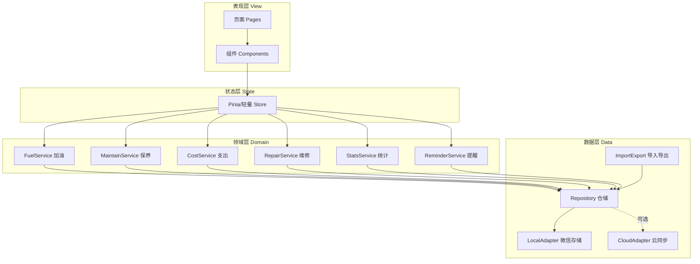
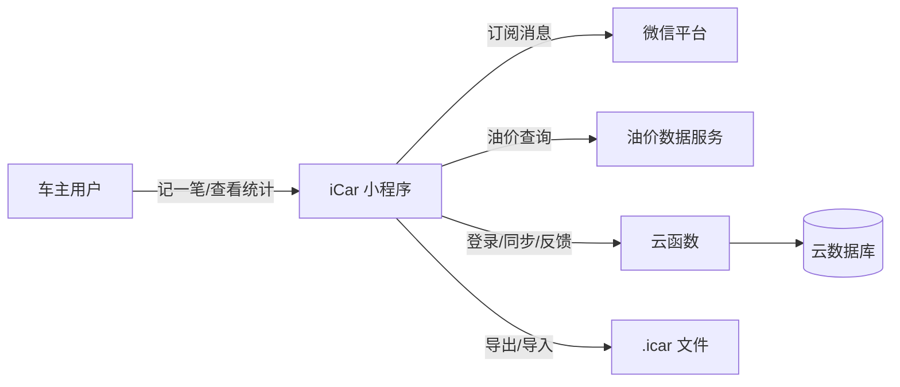
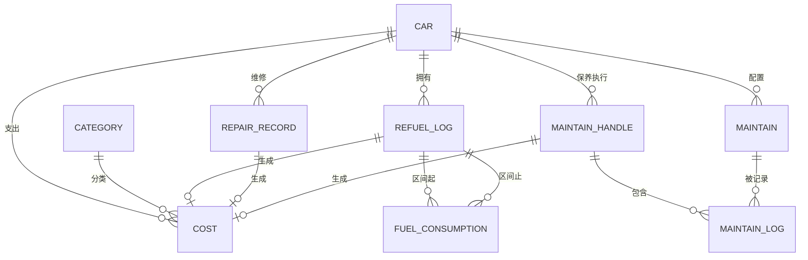
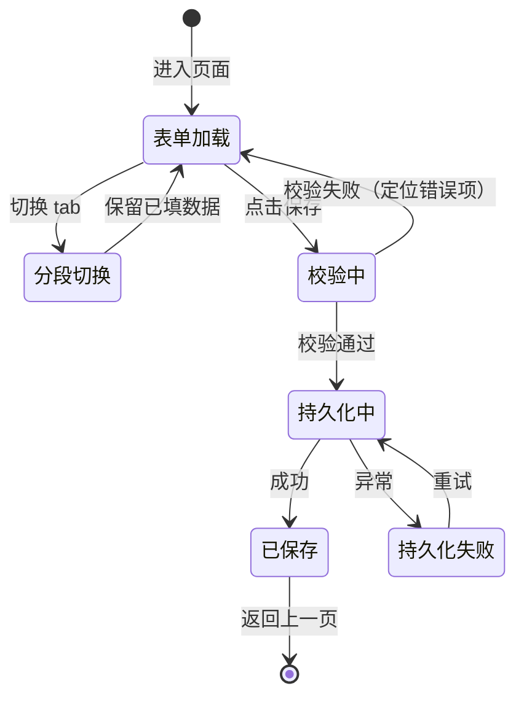
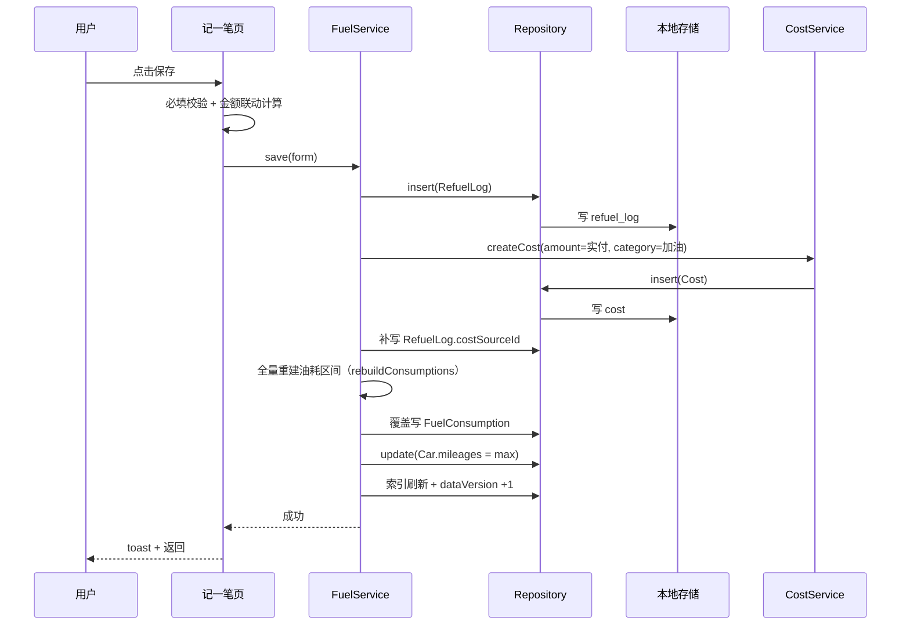
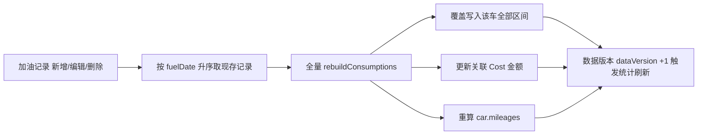
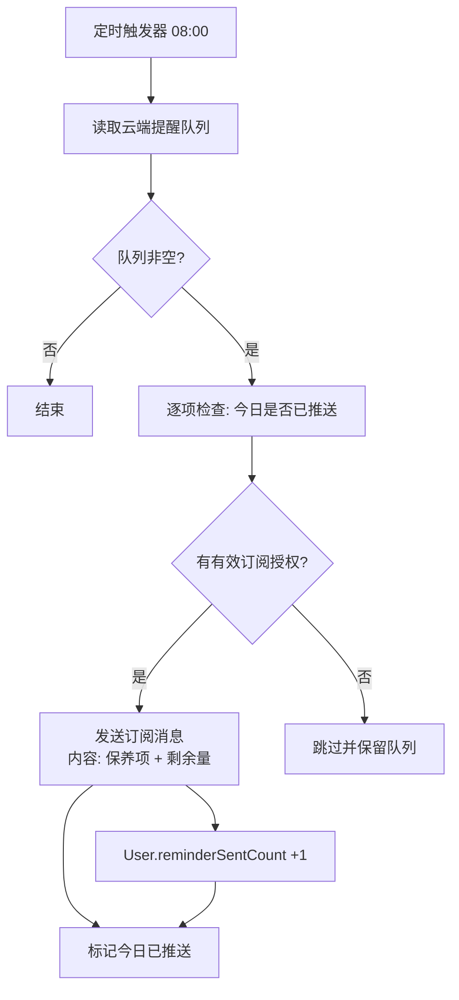
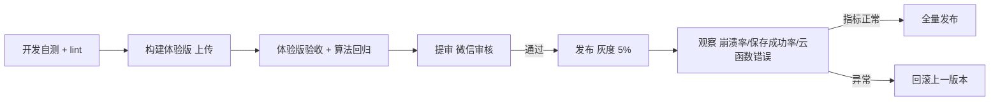

# iCar 车辆管理小程序 —— 软件设计报告

| 项 | 内容 |
| --- | --- |
| 项目名称 | iCar（仓库名 myCar）车辆管理与用车记账小程序 |
| 文档名称 | 软件设计报告（Software Design Report, SDR） |
| 版本 | V1.3 |
| 状态 | 评审稿（含 V1 实现状态） |
| 编写日期 | 2026-10-21 |
| 适用端 | 微信小程序（主）/ App（规划，uni-app x 复用逻辑层） |
| 代码仓库 | `e:/wangyuan/codeBuddy/iCar/iCar` |
| 许可协议 | Apache License 2.0（见 `LICENSE`） |
| 依据材料 | `图片/` 下 11 张界面原型截图；`iCar-export-20261021-170555.icar/manifest.json`（真实数据导出样本） |

## 修订记录

| 版本 | 日期 | 修订人 | 说明 |
| --- | --- | --- | --- |
| V0.1 | 2026-10-21 | iCar Team | 初稿：需求、数据模型、算法口径 |
| V1.0 | 2026-10-21 | iCar Team | 补齐架构、接口、测试、发布计划，形成评审稿 |
| V1.1 | 2026-10-21 | iCar Team | 新增「统计看板」(S10) 与「保养状态」(S11) 两页需求、统计口径 BR-16~24、`buildStats` 聚合实现与图表方案；修正加油记录时间轴（UTC+8）与保养进度条语义（剩余比例） |
| V1.2 | 2026-10-21 | iCar Team | 按可行性审查 P0 清单修订：①新增 `Car.initMileages` 字段并统一保养基线；②新增 `User` 实体（偏好/会员/提醒次数）接入存储/导出/同步；③订阅提醒改为本地队列 + 云函数定时触发推送；④定义加油记录增删改的区间全量重算与 Cost 联动；⑤订正本地写入一致性（补偿+对账）、加密密钥管理与删除语义 |
| V1.3 | 2026-10-22 | iCar Team | 新增第 15 章「实现状态」：交付概览、FR 实现矩阵（✅/◐/○）、超出原设计的新增能力（车辆置顶、毛玻璃 TabBar、图标选择器、每车阈值等）、与设计的偏差说明、实际路由对照、未实现清单与优先级 |

---

## 目录

1. [引言](#1-引言)
2. [需求分析](#2-需求分析)
3. [系统总体设计](#3-系统总体设计)
4. [数据设计](#4-数据设计)
5. [详细设计](#5-详细设计)
6. [界面与交互设计规范](#6-界面与交互设计规范)
7. [代码结构与关键实现](#7-代码结构与关键实现)
8. [接口设计](#8-接口设计)
9. [非功能性设计](#9-非功能性设计)
10. [测试方案](#10-测试方案)
11. [部署、发布与运维](#11-部署发布与运维)
12. [项目计划与里程碑](#12-项目计划与里程碑)
13. [风险与对策](#13-风险与对策)
14. [附录](#14-附录)
15. [实现状态（V1 交付追踪）](#15-实现状态v1-交付追踪)

---

## 1. 引言

### 1.1 编写目的

本文档描述 iCar 车辆管理小程序（以下简称"iCar"）的软件设计方案，明确其需求边界、系统架构、数据模型、核心算法口径、接口契约与测试策略，作为后续编码实现、联调测试与上线验收的共同依据。

本文档的读者为：产品负责人、前端/小程序开发、后端（云开发）开发、测试与运维人员。

### 1.2 项目背景

个人车主在用车过程中会产生四类高频、碎片化的记录数据：**加油**、**保养**、**维修**、**支出**（停车费、过路费、车内用品等杂费）。这些数据分散在纸质小票、加油机小票与微信聊天记录中，导致：

- 无法回答"这箱油到底跑了多少公里、每公里花多少钱"；
- 不知道机油、机滤、空滤什么时候该换，容易超期保养；
- 年度养车总支出无统计，做不了成本复盘。

iCar 以"**一页记一笔**"为交互核心，把四类记录统一为"记一笔"表单（分段选择器切换），并自动派生油耗、保养剩余量与年度统计，替代传统需要多表关联的车辆档案 App。

现有 `iCar-export-20261021-170555.icar/manifest.json` 表明：原型应用已产生真实数据（1 辆车、6 个支出类别、6 个保养项、10 条加油记录、6 段油耗区间、23 条支出、1 次保养执行），其数据模型的字段命名（如 `sourceId` / `deleted` / `updatedAt`）具备跨端同步与增量导入导出特征，本设计沿用该模型以保证**历史数据零迁移**。

### 1.3 术语与缩略语

| 术语 | 说明 |
| --- | --- |
| 记一笔 | 录入加油/保养/维修/支出记录的统一表单页 |
| 油耗区间 (FuelConsumption) | 两次相邻加油记录之间构成的一个统计区间 |
| 加油锚点 | 区间内标记为"加满"的加油记录，作为油耗计算的基准点 |
| 保养项 (Maintain) | 一辆车需要周期性更换/检查的部件（机油机滤、刹车油…） |
| 保养执行 (MaintainHandle) | 一次实际发生的保养行为，含日期、里程、备注 |
| 保养明细 (MaintainLog) | 保养执行与具体保养项的关联记录 |
| 支出 (Cost) | 统一的花费流水，携带类别与来源引用 |
| 支出类别 (Category) | 支出的分类，预设类别不可删除，自定义类别可增删改 |
| iCar 包 (.icar) | 应用自定义的数据导出包格式（JSON + 资源），用于备份与迁移 |
| 剩余里程/剩余天数 | 保养项距离下次更换还剩的里程数/天数 |
| Pro | 应用的付费能力包（多车、云同步、报表导出等） |

### 1.4 参考资料

| 编号 | 名称 | 位置 |
| --- | --- | --- |
| R1 | 界面原型截图（11 张，S1–S11） | `图片/Screenshot_2026*.jpg` |
| R2 | iCar 数据导出样本 | `iCar-export-20261021-170555.icar/manifest.json` |
| R3 | 微信小程序开发文档 | 微信开放文档（框架、订阅消息、云开发） |
| R4 | Apache License 2.0 | `LICENSE` |

---

## 2. 需求分析

### 2.1 用户角色

| 角色 | 描述 | 核心诉求 |
| --- | --- | --- |
| 普通车主（主要用户） | 拥有 1 辆车或摩托车/电动车，通勤+长途混合用车 | 快速记账、随时知道该保养什么、油耗多少钱一公里 |
| 多车用户 | 家庭 2 辆及以上车辆 | 车辆切换、按车统计费用 |
| 数据迁移用户 | 从其他 App/纸质记录迁移 | 批量导入、导出备份、不丢历史数据 |

系统不设管理员角色，所有数据归属个人账户（微信 OpenID）。

### 2.2 产品目标与范围

**目标**

1. 单次记录录入 ≤ 20 秒（默认项自动带出，必填项 ≤ 3 个）。
2. 加油后即时得出"本次油耗 L/100km"与"元/公里"。
3. 保养到期前主动提醒（订阅消息），并能一眼看到每项保养还剩多少。
4. 统计页 3 秒内读懂"钱花在哪、油耗什么趋势"：分类占比 + 油耗趋势 + 月度行程/费用。
5. 数据 100% 本地可导出，格式开放（.icar / CSV）。

**范围（V1 交付）**

- 车辆档案：增删改查、车型名称、里程、能量类型（燃油/纯电/混动）。
- 记一笔：加油、保养、维修、支出 四类表单。
- 记录查询：按类型分 Tab 的时间倒序流水列表。
- 车辆详情：油耗统计、年度统计、保养进度、最近支出。
- 保养提醒：到期项汇总 + 订阅消息推送。
- 保养状态：全量保养项剩余量与剩余比例、添加/编辑保养项。
- **统计看板：月/年/全部三维度，里程/油耗/支出三组指标 + 分类支出环形图 + 油耗趋势折线 + 行程/费用柱状图。**
- 支出类别管理：预设只读 + 自定义增删改。
- 用户中心：会员状态、提醒开关、提醒次数统计、导入导出、FAQ、反馈、更新日志、分享。
- 数据导入导出（.icar）。

**范围外（V2+）**

- 多人共享车辆（家庭成员协作）。
- 保养件价格库与比价。
- 报表 PDF/表格导出（统计页图片分享 V2）。
- 违章、保险、年检等车务提醒。
- 加油站/充电站 POI 与站内油价地图（V1 仅展示列表中某一条油价，见 R1 第 9 张）。

### 2.3 功能需求清单

优先级定义：P0 必须有；P1 应该有；P2 可以有。

#### 2.3.1 车辆档案

| 编号 | 名称 | 描述 | 优先级 |
| --- | --- | --- | --- |
| FR-CAR-01 | 车辆列表 | 展示全部车辆（图标、名称、当前里程），支持新增/编辑/删除 | P0 |
| FR-CAR-02 | 当前里程 | 由最新一次记录（加油/保养/维修）回写车辆总里程，≥ 0 整数 | P0 |
| FR-CAR-03 | 能量类型 | `fuel` 燃油 / `ev` 纯电 / `hybrid` 混动，决定加油表单与充电分支 | P0 |
| FR-CAR-04 | 购车日期 | `initDate`，用于年度统计与首保基线 | P1 |
| FR-CAR-05 | 车辆图标 | 内置图标集 + 自定义图片（`customIconAssetId`） | P1 |

#### 2.3.2 记一笔（统一表单容器）

| 编号 | 名称 | 描述 | 优先级 |
| --- | --- | --- | --- |
| FR-FRM-01 | 分段切换 | 顶部四个分段：记加油 / 记保养 / 记维修 / 记支出，切换不丢已填数据 | P0 |
| FR-FRM-02 | 必填校验 | 必填项缺失时阻止保存并聚焦到首个错误项 | P0 |
| FR-FRM-03 | 保存反馈 | 保存成功 toast 并返回上一页；失败给出具体原因 | P0 |
| FR-FRM-04 | 编辑态复用 | 同一表单页支持"新建"与"编辑已有记录"两种模式 | P1 |
| FR-FRM-05 | 草稿 | 页面退出前保存草稿，下次进入自动回填 | P2 |

#### 2.3.3 记加油

对应 R1 第 1 张（`Screenshot_2026_1021_165005.jpg`）。

| 编号 | 名称 | 描述 | 优先级 |
| --- | --- | --- | --- |
| FR-FUEL-01 | 基本信息 | 加油日期（日期+时间，默认当前）、加油时里程（默认车辆当前里程，必填） | P0 |
| FR-FUEL-02 | 油量信息 | 单价(元/升) × 加油量(升) = 应付金额(元)，三者联动计算，保留 2 位小数 | P0 |
| FR-FUEL-03 | 实付金额 | 默认可编辑，默认等于应付金额（优惠券/满减场景） | P0 |
| FR-FUEL-04 | 上次加油记了吗 | 单选：记了 / 没记（`lastRecorded`），影响油耗区间是否可计算 | P0 |
| FR-FUEL-05 | 加满了吗 | 单选：加满 / 没加满（`isFull`），油耗锚点判据 | P0 |
| FR-FUEL-06 | 加油前油量低吗 | 单选：低 / 不低（`isLowFuel`），用于油量趋势与区间边界判定 | P0 |
| FR-FUEL-07 | 充电百分比 | 仅 `energyType=ev` 时展示充电前/后百分比（`chargeBeforePercent` / `chargeAfterPercent`） | P1 |
| FR-FUEL-08 | 备注 | 选填文本 | P1 |
| FR-FUEL-09 | 产生支出流水 | 保存加油记录时同步写入 `Cost`（类别=加油，金额=实付金额） | P0 |
| FR-FUEL-10 | 区间油耗即时预览 | 表单内实时显示"距上次 X km，本次油耗 Y L/100km" | P1 |

#### 2.3.4 记保养

对应 R1 第 4 张（`Screenshot_20261021_165009.jpg`）。

| 编号 | 名称 | 描述 | 优先级 |
| --- | --- | --- | --- |
| FR-MTN-01 | 选择保养项 | 多选标签：机油机滤、空调滤芯、空气滤芯、刹车油、变速箱油、火花塞…（按车模板预置，可增删） | P0 |
| FR-MTN-02 | 保养信息 | 里程（必填）、保养日期（必填，日期选择器） | P0 |
| FR-MTN-03 | 支出信息 | 支出金额（选填）、备注（选填） | P0 |
| FR-MTN-04 | 生成保养执行 | 一次保存生成 1 条 `MaintainHandle` + N 条 `MaintainLog`（N = 选中项数） | P0 |
| FR-MTN-05 | 关联支出 | 支出写入 `Cost`，`maintainHandleSourceId` 指向本次保养执行 | P0 |
| FR-MTN-06 | 重置剩余量 | 保养完成后所选保养项的剩余里程/天数按本次保养基准重算 | P0 |
| FR-MTN-07 | 保养项管理 | 设置保养周期（里程/天数/月份）、排序、启用停用 | P1 |

#### 2.3.5 记维修

对应 R1 第 2 张（`Screenshot_2026_1021_165018.jpg`）。

| 编号 | 名称 | 描述 | 优先级 |
| --- | --- | --- | --- |
| FR-RPR-01 | 维修信息 | 维修内容（必填）、里程（自动带出，可改）、维保日期（必填） | P0 |
| FR-RPR-02 | 图片上传 | 最多 3 张（`0/3` 计数），相册/拍照，压缩后存储 | P0 |
| FR-RPR-03 | 支出信息 | 支出金额（选填）、备注（选填） | P0 |
| FR-RPR-04 | 产生支出流水 | 写入 `Cost`（类别=维修），`repairSourceId` 关联 | P0 |
| FR-RPR-05 | 图片本地持久化 | 图片存本地文件系统，导出时打包进 .icar 资源区（`imageMode=file`） | P1 |

#### 2.3.6 记支出

对应 R1 第 5 张（`Screenshot_20261021_165024.jpg`）。

| 编号 | 名称 | 描述 | 优先级 |
| --- | --- | --- | --- |
| FR-CST-01 | 支出类别选择 | 横向图标选择器：保养/维修/充电/加油/停车费/杂费…（可横向滚动） | P0 |
| FR-CST-02 | 支出信息 | 金额（必填）、支出日期（必填）、备注（选填） | P0 |
| FR-CST-03 | 跳转类别管理 | 右上"类别管理"入口 | P0 |
| FR-CST-04 | 类别图标 | 预设图标集（maintain/fix/ev/oil/p/ticket…）+ 自定义上传 | P1 |

#### 2.3.7 支出类别管理

对应 R1 第 6 张（`Screenshot_20261021_165027.jpg`）。

| 编号 | 名称 | 描述 | 优先级 |
| --- | --- | --- | --- |
| FR-CAT-01 | 预设只读 | 保养/维修/充电/加油 标注"预设分类，不能改动" | P0 |
| FR-CAT-02 | 自定义增删改 | 停车费、杂费等可编辑名称/图标、删除 | P0 |
| FR-CAT-03 | 添加类别 | 底部"添加类别"按钮，弹层输入名称+选图标 | P0 |
| FR-CAT-04 | 删除保护 | 存在支出流水的类别不允许删除，提示"该类别下有 N 条记录" | P0 |
| FR-CAT-05 | 排序 | 支持拖拽排序 | P2 |

#### 2.3.8 车辆详情

对应 R1 第 3 张（`Screenshot_2026_1021_165043.jpg`）。

| 编号 | 名称 | 描述 | 优先级 |
| --- | --- | --- | --- |
| FR-DTL-01 | 车辆头部 | 图标、名称、当前里程（km）、里程说明入口 | P0 |
| FR-DTL-02 | 最近油耗 | 展示最近一个有效油耗区间的 L/100km、行驶里程、元/公里 | P0 |
| FR-DTL-03 | 平均油耗 | 全量有效区间的加权平均 L/100km、累计里程、元/公里 | P0 |
| FR-DTL-04 | 今年统计 | 平均油耗、总支出、总里程 | P0 |
| FR-DTL-05 | 保养进度 | 保养项列表 + 进度条 + 剩余里程/剩余天数，点击进入保养提醒页 | P0 |
| FR-DTL-06 | 近期支出 | 最近支出流水（图标+类别名+日期+地点备注+金额） | P0 |
| FR-DTL-07 | 更多入口 | 右上角"全部记录"跳转车辆记录页；右侧悬浮"+"快速记一笔 | P0 |

#### 2.3.9 车辆记录（分类型流水）

对应 R1 第 7 张（`Screenshot_20261021_165104.jpg`）。

| 编号 | 名称 | 描述 | 优先级 |
| --- | --- | --- | --- |
| FR-LST-01 | 类型 Tab | 加油 / 保养 / 维修 / 支出 四个 Tab 切换 | P0 |
| FR-LST-02 | 加油卡片 | 时间 + 里程；单价 × 升数；金额；标签（加满 / 油量低）；区间油耗三元组（L/100km、元/km、里程） | P0 |
| FR-LST-03 | 保养卡片 | 保养项名称（多选合并）、里程、日期、金额 | P0 |
| FR-LST-04 | 维修卡片 | 维修内容、图片缩略图、里程、日期、金额 | P0 |
| FR-LST-05 | 支出卡片 | 类别图标 + 名称、日期、备注、金额 | P0 |
| FR-LST-06 | 卡片展开 | 点击卡片展开区间统计条（非加油卡片不展开） | P1 |
| FR-LST-07 | 滑动操作 | 左滑删除（带二次确认）、长按编辑 | P1 |
| FR-LST-08 | 分页/下拉刷新 | 上拉加载更多、下拉刷新 | P1 |

#### 2.3.10 保养提醒

对应 R1 第 9 张（`Screenshot_20261021_165111.jpg`）。

| 编号 | 名称 | 描述 | 优先级 |
| --- | --- | --- | --- |
| FR-RMD-01 | 油价条 | 顶部展示省份、当前油价（¥8.63/L）、油品标号（92#），可切换标号 | P1 |
| FR-RMD-02 | 车辆卡片 | 车名、当前里程、车辆图标 | P0 |
| FR-RMD-03 | 保养项油瓶图 | 每个保养项以油瓶形进度条呈现剩余比例 | P0 |
| FR-RMD-04 | 紧急项提示 | 取最紧急保养项，提示"👍 空气滤芯 还有17092km" | P0 |
| FR-RMD-05 | 到期判定 | 剩余里程 ≤ 阈值 或 剩余天数 ≤ 阈值 时进入提醒列表并触发通知 | P0 |
| FR-RMD-06 | 提醒开关 | 用户中心可关闭/开启保养到期提醒 | P0 |
| FR-RMD-07 | 提醒次数统计 | 累计推送提醒条数（用户中心展示） | P1 |

> **与「保养状态」页（S11）的分工**：S9 是以**车辆**为中心的提醒视图（油瓶图 + 最紧急项），强调"该不该去保养"；S11 是以**保养项**为中心的全量视图（列表 + 剩余比例 + 添加保养项），强调"每一项还剩多少"。两页共用 5.3.2 的剩余量算法，仅展示形态不同。

#### 2.3.11 用户中心

对应 R1 第 8 张（`Screenshot_20261021_165114.jpg`）。

| 编号 | 名称 | 描述 | 优先级 |
| --- | --- | --- | --- |
| FR-USR-01 | 账户信息 | 微信头像/昵称、会员状态（Pro 已过期/开通/开通按钮） | P0 |
| FR-USR-02 | 保养到期提醒 | 开关 + 提醒次数展示 | P0 |
| FR-USR-03 | 支出类别管理 | 跳转列表 | P0 |
| FR-USR-04 | 数据导入导出 | 导出 .icar 包；导入 .icar 包并合并/覆盖 | P0 |
| FR-USR-05 | 常见问题 | FAQ 列表页 | P1 |
| FR-USR-06 | 反馈与建议 | 文本反馈 + 联系方式，可上传图片 | P1 |
| FR-USR-07 | 更新日志 | 版本变更记录 | P1 |
| FR-FRN-08 | 分享给好友 | 生成分享卡片（分享车辆/统计图） | P2 |
| FR-USR-09 | 底部导航 | 提醒 / 车辆 / 更多 三 Tab | P0 |

#### 2.3.12 保养状态（全量保养项）

对应 R1 第 11 张（`Screenshot_20261021_182410.jpg`）。

| 编号 | 名称 | 描述 | 优先级 |
| --- | --- | --- | --- |
| FR-MST-01 | 全量列表 | 按 `sortOrder` 展示该车全部保养项（样本 6 项），每项一张卡片 | P0 |
| FR-MST-02 | 剩余量文案 | `剩余 295 天` / `剩余 17092 km`；未配置的周期维度不展示 | P0 |
| FR-MST-03 | 剩余比例进度条 | 蓝色填充长度 = 剩余量 ÷ 周期值（见 5.3.2 校验） | P0 |
| FR-MST-04 | 详情入口 | 右上"详情"进入保养项管理（周期编辑、排序、停用） | P0 |
| FR-MST-05 | 添加保养项 | 底部"+ 添加保养项"，可从模板库选择或自定义名称与周期 | P0 |
| FR-MST-06 | 与详情的层级关系 | S3 车辆详情只展示前 4 项 + "更多"，本页为全量视图 | P0 |
| FR-MST-07 | 紧急排序 | 可选"按紧急度排序"，将 `urgent=true` 的项置顶 | P1 |

#### 2.3.13 统计看板

对应 R1 第 10 张（`Screenshot_2026_1021_182208.jpg`）。

| 编号 | 名称 | 描述 | 优先级 |
| --- | --- | --- | --- |
| FR-STA-01 | 时间维度 | 顶部 `月 / 年 / 全部` 分段器 + 年份下拉（2026年）+ 月份下拉 | P0 |
| FR-STA-02 | 里程数据 | 最新总里程、增加总里程、加油里程三个指标 | P0 |
| FR-STA-03 | 油耗数据 | 总油费（元）、平均油耗（L/100km）、平均油耗（元/km） | P0 |
| FR-STA-04 | 支出数据 | 总支出（元）、每公里支出（元/km）、除掉油费支出（元/km） | P0 |
| FR-STA-05 | 分类支出环形图 | 各支出类别金额占比环形图 + 右侧总支出，下方类别明细列表（图标/名称/金额） | P0 |
| FR-STA-06 | 油耗趋势折线图 | 按时间升序的区间油耗率折线，Y 轴 0–15，X 轴为区间终点日期 | P0 |
| FR-STA-07 | 行程柱状图 | 按月汇总区间里程，右上显示合计值（1791 km） | P0 |
| FR-STA-08 | 费用柱状图 | 按月汇总支出，右上显示合计值（¥3529.90） | P0 |
| FR-STA-09 | 空态与降级 | 无数据时展示占位文案；图表渲染失败时降级为纯数字摘要 | P0 |
| FR-STA-10 | 入口 | 车辆详情"今年统计"卡片点击进入本页 | P0 |
| FR-STA-11 | 图表交互 | 折线/柱状图点击显示数值气泡；环形图点击高亮对应扇区 | P1 |
| FR-STA-12 | 分享/导出 | 统计页生成图片分享（V2） | P2 |

### 2.4 界面与交互原型说明

| 编号 | 截图文件 | 页面 | 关键组件 |
| --- | --- | --- | --- |
| S1 | `Screenshot_2026_1021_165005.jpg` | 记一笔-记加油 | 分段器、日期时间选择、单价×油量=金额三联输入、三组单选按钮、备注、主按钮 |
| S2 | `Screenshot_2026_1021_165018.jpg` | 记一笔-记维修 | 维修内容、里程、日期、图片九宫格(0/3)、支出金额 |
| S3 | `Screenshot_2026_1021_165043.jpg` | iCar-车辆详情 | 油耗双卡片、深色年度统计卡、保养进度列表、近期支出列表、悬浮按钮 |
| S4 | `Screenshot_20261021_165009.jpg` | 记一笔-记保养 | 保养项多选标签、里程日期、支出金额 |
| S5 | `Screenshot_20261021_165024.jpg` | 记一笔-记支出 | 类别图标横向选择、金额、日期、备注 |
| S6 | `Screenshot_20261021_165027.jpg` | 支出类别管理 | 预设只读标签、自定义编辑/删除按钮、添加类别主按钮 |
| S7 | `Screenshot_20261021_165104.jpg` | iCar-车辆记录 | 类型 Tab、加油卡片 + 区间统计条 |
| S8 | `Screenshot_20261021_165114.jpg` | iCar-用户 | 用户卡片、设置项列表、底部导航栏 |
| S9 | `Screenshot_20261021_165111.jpg` | iCar-保养提醒 | 油价条、车辆卡、油瓶进度、紧急提示 |
| S10 | `Screenshot_2026_1021_182208.jpg` | 统计-CRV | 月/年/全部分段、年份月份下拉、三组指标、分类支出环形图、油耗趋势折线、行程/费用柱状图 |
| S11 | `Screenshot_20261021_182410.jpg` | CRV/保养状态 | 全量保养项卡片（剩余量 + 剩余比例进度条）、详情入口、添加保养项 |

**通用交互约定**

- 页面背景浅灰（`#F5F6F8`），内容卡片白底 + 大圆角（≈16px）+ 轻投影。
- 主色蓝 `#3B6FF6`（按钮、选中态、进度条），次级文字灰 `#9AA4B2`，强调色红 `#F5474F`（删除/超期），标签绿 `#E8F7EE`+`#2BA84A`（加满）、标签橙 `#FFF3E0`+`#E8912A`（油量低）。
- 必填项以红色 `*` 标注；禁用态占位文字为浅灰。
- 主按钮通栏、固定在内容区底部（`保存`）。
- 所有金额展示统一保留 2 位小数并加 `¥` 前缀，里程 `km`，油耗 `L/100km`。

### 2.5 业务规则

| 编号 | 规则 |
| --- | --- |
| BR-01 | 加油记录保存时，若实付金额为空则自动取应付金额；应付金额 = 单价 × 加油量（四舍五入 2 位） |
| BR-02 | 加油记录的"加油时里程"若大于车辆当前里程，则回写车辆当前里程；小于则允许（补录历史）但不回写 |
| BR-03 | 油耗区间仅由相邻两条加油记录构成，判定条件见 5.2；不满足条件则该对记录不产生区间 |
| BR-04 | 一次加油最多归属一个油耗区间（与上一条记录配对），不重复计数 |
| BR-05 | 平均油耗 = Σ区间油耗量 ÷ Σ区间里程 × 100；元/公里 = Σ区间金额 ÷ Σ区间里程 |
| BR-06 | 保养项剩余里程 = 保养周期里程 − (车辆当前里程 − 上次保养里程)；无保养记录时以购车里程基线计算 |
| BR-07 | 保养项剩余天数 = 保养周期天数 − (今天 − 上次保养日期)；仅配置了里程周期的保养项只展示剩余里程 |
| BR-08 | 提醒触发条件：剩余里程 ≤ 500km 或 剩余天数 ≤ 15 天；同一保养项同一天最多提醒 1 次 |
| BR-09 | 保养完成后，所选全部保养项的基准（日期+里程）更新为本次保养执行，剩余量重算 |
| BR-10 | 支出类别中 `isPreset=true` 的类别不可编辑、不可删除；存在关联流水的类别不可删除 |
| BR-11 | 删除记录采用软删除（`deleted=true`），参与统计时过滤；30 天后由清理任务物理删除 |
| BR-12 | 车辆总里程 = max(软删除过滤后现存记录的里程)；编辑/删除记录后按现存记录重算（删除导致最大里程记录移除时，总里程回落到次大值） |
| BR-13 | 年度统计口径：统计自然年内（1/1–12/31）的支出合计与油耗区间里程合计 |
| BR-14 | 导入 .icar 时，实体按 `sourceId` 做 Upsert；`updatedAt` 较新者胜出；同 `sourceId` 不同 `sourcePlatform` 视为冲突，提示用户选择 |
| BR-15 | 同一笔加油/保养/维修对应的支出流水与其源记录为一对一的强关联，删除源记录时同步删除流水 |
| BR-16 | 统计维度：`月` = 选中年月的自然月；`年` = 选中年份的自然年；`全部` = 全部历史数据。切换维度重新计算全部指标与图表 |
| BR-17 | 最新总里程 = 选中范围内最后一条记录里程（`all` 维度即 `car.mileages`）；增加总里程 = 范围内最大记录里程 − 最小记录里程 |
| BR-18 | 加油里程 = Σ范围内有效油耗区间里程（≠ 总里程差，区间不连续时段不计入） |
| BR-19 | 总油费 = Σ范围内加油记录 `actualPayAmount`（含未构成区间的加油，如只加半箱） |
| BR-20 | 平均油耗（L/100km）= Σ区间油耗量 ÷ Σ区间里程 × 100；平均油耗（元/km）= **总油费 ÷ 加油里程** |
| BR-21 | 每公里支出 = 总支出 ÷ 增加总里程；除掉油费支出（元/km） = （总支出 − 总油费）÷ 增加总里程 |
| BR-22 | 分类支出占比 = 该类金额 ÷ 总支出 × 100，展示保留 2 位小数；因四舍五入导致合计 ≠ 100% 时，差额补入占比最大的类别 |
| BR-23 | 行程图按月归属：区间**终点**日期所在月；费用图按月归属：`Cost.costDate` 所在月；无数据月份不补零（柱状图只画有数据的月） |
| BR-24 | 油耗趋势折线按区间终点时间升序排列，Y 轴固定 0–15；有效区间 < 2 个时降级为"数据不足，继续记录后生成趋势" |
| BR-25 | 任何加油记录增、删、改（里程/油量/加满标志/低油量标志）后，该车全部油耗区间按 5.2 规则**全量重算**（基于软删除过滤后的现存记录）；删除中间记录后，原本不相邻的两条按时间轴重新配对判定 |
| BR-26 | 编辑加油记录的实付金额时，同步更新其关联 `Cost.amount`；删除加油记录时，软删其关联 `Cost`；编辑里程回写车辆总里程后按 BR-12 重算 |

### 2.6 非功能需求

| 编号 | 类别 | 要求 |
| --- | --- | --- |
| NFR-01 | 性能 | 首页冷启动 ≤ 1.5s（iPhone 12 / 低端安卓 ≤ 2.5s）；列表滚动 60fps；单次记录保存 ≤ 300ms |
| NFR-02 | 容量 | 本地数据支持 ≥ 20 辆车、≥ 20000 条记录、≥ 500MB 图片，存储占用 < 200MB（微信单 key 1MB / 总量 10MB 限制内） |
| NFR-03 | 离线 | 全部核心功能（记录、统计、提醒计算）离线可用；仅会员云同步与油价查询需要网络 |
| NFR-04 | 安全 | 数据本地明文存储，依赖微信沙箱隔离（Storage 仅本小程序可读）；敏感字段（OpenID、PIN）混淆/哈希；不采集位置、通讯录等非必要信息；应用锁与 AES 加密为 V2 |
| NFR-05 | 隐私合规 | 首次启动展示《隐私政策》与《用户协议》；头像昵称按需申请（`getUserProfile`）；相机/相册/位置按需申请并说明用途 |
| NFR-06 | 可用性 | 无障碍：点击区域 ≥ 44×44pt，正文对比度 ≥ 4.5:1，全部操作有文字反馈 |
| NFR-07 | 兼容 | 微信基础库 ≥ 2.30.0；iOS 14+ / Android 9+；深色模式跟随系统（V1.1） |
| NFR-08 | 可维护 | 领域逻辑与 UI 解耦，核心算法单测覆盖率 ≥ 80%，整体 ≥ 60% |
| NFR-09 | 可观测 | 关键链路埋点（保存成功率、统计计算耗时、导入导出结果），异常上报到云端日志 |
| NFR-10 | 国际化 | V1 仅简体中文；文案集中管理（`i18n/zh-CN.ts`），预留多语言结构 |
| NFR-11 | 图表 | 统计页三张图首帧渲染 ≤ 100ms；维度切换端到端（筛选+聚合+重绘）≤ 200ms；图表按需绘制、离屏复用 |
| NFR-12 | 统计精度 | 金额计算使用整数分（`Math.round(x*100)`）避免浮点误差；占比合计恒为 100.00%；禁止出现 `NaN`/`Infinity` |

---

## 3. 系统总体设计

### 3.1 架构风格

采用 **Local-First（本地优先）+ 分层架构**：



**设计要点**

- **本地优先**：所有数据先落本地存储并立即可用，UI 由本地状态驱动，零等待。
- **单向数据流**：视图 → Store Action → Service → Repository → 持久化 → Store State 回流 → 视图刷新。
- **领域层无平台依赖**：Service 只依赖 Repository 接口，便于未来在 App 端（SQLite）与小程序端（wx storage）之间复用同一套逻辑。
- **云能力可插拔**：云同步、油价查询、订阅消息通过 Adapter 接入，缺网或未开通时静默降级。

### 3.2 技术选型

| 层面 | 选型 | 理由 |
| --- | --- | --- |
| 端框架 | 微信小程序原生（`WXML/WXSS/JS`）+ TypeScript | 打开即用、无需安装、与微信订阅消息/登录天然契合；用户已有小程序数据 |
| 状态管理 | 自研轻量 Store（`mitt` 事件总线 + 响应式对象） | 数据量小、结构扁平，避免引入 Pinia 的构建成本 |
| 存储 | `wx.setStorage` 分表存储 + 内存索引（LRU） | 无原生数据库依赖；导出样本 `manifest.json` 同为 JSON 分表，映射一致 |
| 图片 | `wx.chooseMedia` + `wx.compressImage`，存 `wx.env.USER_DATA_PATH` | 避免大 blob 进 Storage 触发 1MB 单键限制 |
| 后端 | 微信云开发（云函数 + 云数据库 + 云存储） | 免运维、与小程序一体；仅用于登录态、同步、反馈、会员 |
| 订阅消息 | 微信订阅消息（一次性/长期订阅模板）+ 云函数**定时触发器**（每日 08:00） | 保养到期提醒的唯一合规通道；本地只算队列，云端定时推送（见 5.3.3） |
| 油价数据 | 第三方油价 API + 本地缓存（12h） | 提醒页展示，非核心链路 |
| 图表 | 自研 Canvas 2D 轻量图表（环形/折线/柱状），备选 ECharts-for-WeChat（`ec-canvas`） | 仅 3 类静态图，自研可控制在 15KB 内并避免大体积依赖；ECharts 用于复杂交互场景（V2 报表） |
| App 端（规划） | uni-app x（UTS）复用领域层 TS | 与小程序共用模型与算法层，UI 层独立实现 |
| 版本管理 | Git + 语义化版本 | 遵循 Apache-2.0 贡献流程 |

> 决策记录 **ADR-001**：不做后端优先的云端数据库直读写。理由是本产品为单机工具型应用，弱网/离线可用性优先于多端实时同步；同时避免在首版引入登录墙。

### 3.3 系统上下文



### 3.4 模块划分

| 模块 | 职责 | 关键产物 |
| --- | --- | --- |
| `vehicle` 车辆模块 | 车辆档案、里程回写、车辆切换 | 车辆列表、车辆详情 |
| `fuel` 加油模块 | 加油录入、油耗区间派生、充电分支 | 加油记录、油耗区间 |
| `maintain` 保养模块 | 保养项模板、保养执行、剩余量计算、提醒 | 保养进度、提醒列表 |
| `repair` 维修模块 | 维修录入与图片管理 | 维修记录 |
| `cost` 支出模块 | 支出流水、类别管理、统计聚合 | 支出流水、类别 |
| `stats` 统计模块 | 区间聚合、里程/油耗/支出指标、分类占比、月度行程、月度费用、趋势序列 | 统计看板页、车辆详情统计卡 |
| `user` 用户模块 | 登录态、会员、设置项、反馈 | 用户中心 |
| `io` 导入导出模块 | .icar 打包/解析、CSV 导出、冲突合并 | .icar 包 |
| `common` 基础模块 | 存储适配、事件、格式化、校验、UI 组件库 | 公共能力 |

### 3.5 工程目录结构

```
iCar/
├── app.js / app.json / app.ts          # 入口、全局样式、tabBar
├── components/                         # 通用组件
│   ├── segment-tabs/                   # 分段切换器（S1/S4/S5）
│   ├── form-card/                      # 表单卡片容器
│   ├── form-item/                      # 表单项（label + 必填星 + 插槽）
│   ├── radio-pills/                    # 单选药丸组（记了/没记、加满/没加满）
│   ├── tag-select/                     # 多选标签（保养项选择）
│   ├── icon-picker/                    # 图标选择器
│   ├── image-uploader/                 # 图片九宫格（0/3）
│   ├── progress-bar/                   # 进度条（保养进度，S3/S11）
│   ├── oil-bottle/                     # 油瓶进度图（提醒页 S9）
│   ├── amount-input/                   # 金额输入
│   ├── metric-group/                   # 指标组（3 列指标，S10 里程/油耗/支出）
│   ├── charts/                         # Canvas 2D 图表
│   │   ├── donut-chart/                # 分类支出环形图（S10）
│   │   ├── line-chart/                 # 油耗趋势折线（S10）
│   │   └── bar-chart/                  # 行程/费用柱状图（S10）
│   └── empty-state/                    # 空态
├── pages/
│   ├── reminder/                       # 保养提醒（S9）
│   ├── vehicle-list/                   # 车辆列表
│   ├── vehicle-detail/                 # 车辆详情（S3）
│   ├── vehicle-records/                # 车辆记录（S7）
│   ├── statistics/                     # 统计看板（S10）
│   ├── maintain-status/                # 保养状态全量列表（S11）
│   ├── entry/                          # 记一笔（S1/S2/S4/S5）
│   ├── category-manage/                # 支出类别管理（S6）
│   └── user/                           # 用户中心（S8）
├── domain/                             # 领域服务（纯 TS，无 UI 依赖）
│   ├── fuel.service.ts
│   ├── maintain.service.ts
│   ├── cost.service.ts
│   ├── repair.service.ts
│   ├── stats.service.ts                # 统计聚合（5.10）
│   └── reminder.service.ts
├── repositories/                       # 仓储 + 存储适配器
│   ├── storage.adapter.ts
│   ├── cloud.adapter.ts
│   └── *.repository.ts
├── store/                              # 状态
│   ├── index.ts
│   └── modules/{vehicle,fuel,maintain,cost,stats,user}.ts
├── utils/                              # date/amount/validate/id/image/chart
├── cloudfunctions/                     # login / sync / feedback / member
├── specs/                              # .icar 格式说明
└── docs/软件设计报告.md
```

---

## 4. 数据设计

### 4.1 概念模型（ER）



**关键约束**

- `Cost` 与源记录（加油/维修/保养执行）为 1:1，由源记录的 `costSourceId` 反向引用。
- `FuelConsumption` 最多使用两条 `RefuelLog`，且两条记录在时间轴上相邻。
- 所有实体使用 `sourceId`（形如 `mp:refuel-log:6a2d15a6…`）作为**跨端稳定主键**；`sourcePlatform` 标识来源端（`mp` / `app` / `web`）。
- **统计看板（S10）为派生视图，不新增物理表**：全部指标由 `Cost` / `RefuelLog` / `FuelConsumption` / `Category` 实时聚合得出，保证"记录即统计"，避免双写不一致。
- **`User` 为全局单例**（每账号一份，`mp:user:<openid>`），与车辆/业务实体无外键关系，承载偏好、会员与提醒统计；不随车辆切换。

### 4.2 实体与字段定义

> 通用字段（所有实体）：`createdAt`、`updatedAt`（毫秒时间戳）、`deleted`（软删除标记）、`sourceId`、`sourcePlatform`。

#### 4.2.1 Car 车辆

| 字段 | 类型 | 必填 | 默认 | 说明 |
| --- | --- | --- | --- | --- |
| sourceId | string | 是 | - | 主键 `mp:cars:<hex>` |
| name | string | 是 | - | 车型/车辆名称，如 `CRV` |
| type | string | 否 | `car` | `car`/`motorcycle`/`other` |
| icon | string | 否 | `car` | 内置图标名 |
| customIconAssetId | string | 否 | `""` | 自定义图标资源 ID |
| initDate | number | 否 | - | 购车/建档时间戳 |
| initMileages | number | 否 | `0` | **购车/建档时里程 (km)**，保养剩余量"无保养记录"时的里程基线 |
| mileages | number | 是 | `0` | 当前总里程 (km) |
| evMileages | number | 否 | `0` | 纯电里程 (km) |
| hevMileages | number | 否 | `0` | 混动里程 (km) |
| batteryCapacity | number | 否 | `0` | 电池容量 (kWh) |
| energyType | enum | 是 | `fuel` | `fuel`/`ev`/`hybrid` |
| energyTrackingEnabled | boolean | 否 | `true` | 是否记录能量消耗 |

索引：`sourceId`(PK)、`name`

#### 4.2.2 Category 支出类别

| 字段 | 类型 | 必填 | 默认 | 说明 |
| --- | --- | --- | --- | --- |
| name | string | 是 | - | 类别名 |
| icon | string | 否 | `ticket` | 图标标识 |
| isPreset | boolean | 是 | `false` | 是否预设（不可改不可删） |
| presetType | enum | 否 | `""` | `maintain`/`fix`/`ev`/`refuel`/`""` |

预设类别（种子数据）：保养(maintain)、维修(fix)、充电(ev)、加油(oil)。样本数据中另有自定义类别 停车费(p)、杂费(ticket)。

#### 4.2.3 Maintain 保养项

| 字段 | 类型 | 必填 | 默认 | 说明 |
| --- | --- | --- | --- | --- |
| carSourceId | string | 是 | - | 所属车辆 |
| name | string | 是 | - | 保养项名称 |
| icon | string | 否 | `""` | 提醒页油瓶图对应图标 |
| cycleMileages | number | 否 | `0` | 保养周期里程 (km)，0 表示不按里程 |
| cycleDays | number | 否 | `0` | 保养周期天数，0 表示不按天数 |
| cycleMonths | number | 否 | `0` | 保养周期月数 |
| cycleUnit | enum | 否 | `""` | 展示单位 `month`/`day`/`km` |
| cycleValue | number | 否 | `0` | 展示用周期值 |
| mileageSource | enum | 否 | `total` | 里程基准：`total` 总里程 / `ev` / `hev` |
| sortOrder | number | 否 | `0` | 排序 |

种子模板（样本 CRV）：机油机滤(10000km/12月)、空调滤芯(20000km/24月)、空气滤芯(20000km)、刹车油(40000km/48月)、变速箱油(60000km)、火花塞(50000km)。

#### 4.2.4 MaintainHandle 保养执行

| 字段 | 类型 | 必填 | 说明 |
| --- | --- | --- | --- |
| carSourceId | string | 是 | 所属车辆 |
| makeDate | number | 是 | 保养日期时间戳 |
| makeMileages | number | 是 | 保养时里程 (km) |
| makeEVMileages | number | 否 | 保养时纯电里程 |
| makeHEVMileages | number | 否 | 保养时混动里程 |
| remark | string | 否 | 备注，如"首保" |
| costSourceId | string | 否 | 关联支出流水 ID |

#### 4.2.5 MaintainLog 保养明细

| 字段 | 类型 | 必填 | 说明 |
| --- | --- | --- | --- |
| carSourceId | string | 是 | 所属车辆 |
| maintainSourceId | string | 是 | 保养项 ID |
| handleSourceId | string | 是 | 关联的保养执行 ID |
| makeDate / makeMileages | number | 是 | 冗余自保养执行，便于按项查询 |
| totalMileages | number | 是 | 保养后总里程 |
| makeEVMileages / makeHEVMileages | number | 否 | 能量里程 |
| mileageSource | enum | 是 | 里程基准 |
| remark | string | 否 | 备注 |

#### 4.2.6 Cost 支出

| 字段 | 类型 | 必填 | 说明 |
| --- | --- | --- | --- |
| carSourceId | string | 是 | 所属车辆 |
| categorySourceId | string | 是 | 类别 ID |
| amount | number | 是 | 金额（元），2 位小数 |
| costDate | number | 是 | 发生时间戳 |
| remark | string | 否 | 备注/地点，如"东荟城" |
| maintainHandleSourceId | string | 否 | 来源：保养执行 |
| repairSourceId | string | 否 | 来源：维修记录 |
| fuelRecordSourceId | string | 否 | 来源：加油记录 |

#### 4.2.7 RefuelLog 加油记录

| 字段 | 类型 | 必填 | 说明 |
| --- | --- | --- | --- |
| carSourceId | string | 是 | 所属车辆 |
| energyType | enum | 是 | `fuel`/`ev`/`hybrid` |
| fuelDate | number | 是 | 加油时间戳 |
| makeMileages | number | 是 | 加油时里程 (km) |
| makeEVMileages / makeHEVMileages | number | 否 | 能量里程 |
| unitPrice | number | 是 | 单价（元/升），2 位小数 |
| volume | number | 是 | 加油量（升），3 位小数 |
| shouldPayAmount | number | 是 | 应付金额 = 单价 × 加油量 |
| actualPayAmount | number | 是 | 实付金额 |
| isFull | boolean | 是 | 是否加满 |
| isLowFuel | boolean | 是 | 加油前油量是否低 |
| lastRecorded | boolean | 是 | 上次加油是否已被记录 |
| chargeBeforePercent / chargeAfterPercent | number | 否 | 充电前后电量（EV） |
| remark | string | 否 | 备注 |
| costSourceId | string | 否 | 关联支出流水 ID |

#### 4.2.8 RepairRecord 维修记录

| 字段 | 类型 | 必填 | 说明 |
| --- | --- | --- | --- |
| carSourceId | string | 是 | 所属车辆 |
| content | string | 是 | 维修内容 |
| mileage | number | 是 | 维修时里程 (km) |
| repairDate | number | 是 | 维修日期 |
| amount | number | 否 | 维修金额 |
| images | string[] | 否 | 图片资源 ID 数组，最多 3 |
| remark | string | 否 | 备注 |
| costSourceId | string | 否 | 关联支出流水 ID |

> 样本导出中 `repairRecords` 为空数组（尚无维修数据），字段定义依据 S2 界面推导，落地时以 `content`/`mileage`/`repairDate`/`images` 为准。

#### 4.2.9 FuelConsumption 油耗区间

| 字段 | 类型 | 必填 | 说明 |
| --- | --- | --- | --- |
| carSourceId | string | 是 | 所属车辆 |
| energyType | enum | 是 | 能量类型 |
| startFuelRecordSourceId | string | 是 | 区间起点加油记录 |
| endFuelRecordSourceId | string | 是 | 区间终点加油记录 |
| startDate / endDate | number | 是 | 区间起止时间 |
| fuelDate | number | 是 | 归属时间（取终点） |
| mileage | number | 是 | 区间里程 = 终点里程 − 起点里程 |
| fuelAmount | number | 是 | 区间油耗量 (L) |
| fuelConsumption | number | 是 | L/100km = fuelAmount ÷ mileage × 100 |
| cost | number | 是 | 区间金额 (元) |
| costPerKm | number | 是 | 元/公里 = cost ÷ mileage |

> **派生只读**：`FuelConsumption` 由 `RefuelLog` 按 5.2 规则全量重算得出，**不参与云同步、不参与软删除、不提供手工编辑**；导出时作为冗余数据带出，导入时以源数据重算为准（见 4.5）。

#### 4.2.10 User 用户与偏好

单例实体，每账号（`openid`）一份，主键固定 `mp:user:<openid>`；与车辆数据解耦（不随车切换），承载全局设置、会员与提醒统计。

| 字段 | 类型 | 必填 | 默认 | 说明 |
| --- | --- | --- | --- | --- |
| sourceId | string | 是 | - | `mp:user:<openid>` |
| openid | string | 是 | - | 微信 OpenID（仅云端/本地混淆存储，见 9.2） |
| nickname | string | 否 | `""` | 昵称 |
| avatarUrl | string | 否 | `""` | 头像 URL |
| remindEnabled | boolean | 是 | `true` | 保养到期提醒总开关 |
| reminderSentCount | number | 是 | `0` | 累计已推送提醒条数 |
| memberLevel | enum | 是 | `free` | `free` / `pro` |
| memberExpireAt | number | 否 | `0` | 会员到期时间戳（`0` 表示未开通） |
| appLockEnabled | boolean | 否 | `false` | 应用锁开关（V2） |
| appLockPin | string | 否 | `""` | 应用锁 PIN 的加盐哈希（V2，绝不明文） |
| lastPulledAt | number | 否 | `0` | 最近一次云同步时间（增量游标） |
| createdAt / updatedAt / deleted | - | - | - | 通用字段 |

> 说明：`reminderSentCount` 为**统计值**（累计推送条数），不参与云同步的"较新者胜出"合并，而是取两端最大值；`openid` 不导出、不上本地明文。

### 4.3 数据字典（枚举）

| 枚举 | 取值 | 含义 |
| --- | --- | --- |
| `energyType` | `fuel` / `ev` / `hybrid` | 能源类型 |
| `presetType` | `maintain` / `fix` / `ev` / `refuel` / `""` | 预设类别类型（与业务强绑定，改名会影响统计口径，故不可改） |
| `mileageSource` | `total` / `ev` / `hev` | 里程统计来源 |
| `cycleUnit` | `km` / `day` / `month` | 保养周期展示单位 |
| `sourcePlatform` | `mp` / `app` / `web` | 数据来源端 |

### 4.4 存储方案

**本地存储分层**

| 存储 | 内容 | 形式 | 策略 |
| --- | --- | --- | --- |
| `wx.setStorageSync('icar:index')` | 各表 ID 索引与元信息 | JSON | 主键表，变更即写 |
| `wx.setStorageSync('icar:<table>:<id>')` | 单条实体 | JSON | 记录级读写，避免整表重写 |
| `wx.setStorageSync('icar:user')` | User 单例实体 | JSON | 单 key 独立存储，变更即写（`openid` 混淆，见 9.2） |
| `wx.setStorageSync('icar:meta')` | schema 版本、导出时间 | JSON | 启动时校验 |
| 用户文件系统 | 维修图片 | 文件 | 导出时打包为 `assets/` |

**为什么记录级存储**：微信 Storage 单 key 上限 1MB、单用户总量上限 10MB。车辆场景下 2 万条记录若整表存储，单表 JSON 约 6–10MB 将触顶；记录级存储使新增/修改为 O(1) 写入，读取通过索引批量拉取。

**写入一致性（V1.2）**：微信 Storage 无事务语义，采用**"先写实体、后写索引、失败补偿"**——每条实体写成功后立即更新索引；若进程中断导致索引与实体不一致，启动时执行 `rebuildIndex()`（扫描 `icar:<table>:*` 重建索引，丢弃孤儿实体）。不承诺多 key 原子性，依赖幂等 `sourceId` 与启动对账兜底（详见 7.7）。

**内存缓存**：启动时加载 `icar:index`、`icar:user` 与近 30 天记录到内存 Map，全量统计类计算（年度统计）在内存完成；超过 2000 条时按时间窗口分片加载。

**云端存储（可选，Pro）**：云数据库集合 `icar_{cars,costs,fuel_records,...}` 与 `icar_user`，`_id = sourceId`，`updatedAt` 做增量同步，冲突按 `updatedAt` 较新者胜出（`User.reminderSentCount` 例外，取两端最大值，见 4.2.10）。软删除通过 tombstone 传播（见 4.5）。

### 4.5 导入导出格式（.icar）

沿用样本 `manifest.json` 结构，扩展为标准包：

```
iCar-export-20261021-170555.icar/
├── manifest.json      # 元信息 + 全部业务数据
└── assets/            # 图片资源（manifest.assets 中登记）
```

`manifest.json` 顶层字段：

| 字段 | 类型 | 说明 |
| --- | --- | --- |
| format | string | 固定 `icar-export` |
| version | number | 格式版本，当前 `1` |
| source | object | `platform` / `appVersion` / `exportedAt` |
| options | object | `amountUnit`(`yuan`) / `timeUnit`(`ms`) / `imageMode`(`file`) / `package`(`zip`) |
| warnings | array | 导出告警（如数据裁剪、未知版本） |
| data | object | 10 张表：cars / categories / maintains / maintainHandles / maintainLogs / costs / repairRecords / fuelRecords / fuelConsumptions / **user**（`user.openid` 不导出） |
| assets | array | 资源清单：`{ assetId, type, path, mime, size }` |

**导出流程**

1. 读取各表实体 → 剔除 `deleted=true` → 按 `sourceId` 排序，保证导出幂等。
2. `user` 单例导出：剥离 `openid`（不导出），保留 `remindEnabled`/`reminderSentCount`/会员展示态等。
3. 图片从 `USER_DATA_PATH` 复制到 `assets/`，在 `assets` 中登记。
4. 写 `manifest.json`，`source.platform` 填当前端。
5. 打包为 zip（小程序端可用 `wx.getFileSystemManager` + 第三方 zip 库，或交由云函数打包）。
6. 通过 `wx.shareFileMessage` / `wx.saveFile` 分享或保存。

**导入流程**

1. 用户选择 `.icar` 文件（`wx.chooseMessageFile`）。
2. 解析 `manifest.json`，校验 `format` 与 `version`；版本高于当前则拒绝并提示升级。
3. 逐表 Upsert：`sourceId` 不存在 → 新增；存在且 `updatedAt` 更小 → 跳过；`sourceId` 相同但 `sourcePlatform` 不同 → 记入 `warnings` 并按 `updatedAt` 决定；`deleted=true` 的记录按 tombstone 处理（见下）。
4. 导入 `user` 表：若本地已存在，仅合并 `remindEnabled`（取更"新"者）与 `reminderSentCount`（取 max），不覆盖本地 `openid` 与会员状态（会员以云端订单为准）。
5. 重建 `fuelConsumptions`：无论包内是否携带，均**按源数据全量重算**（5.2），以包内 `RefuelLog` 为准，忽略包内 `FuelConsumption`。
6. 重建车辆当前里程 `car.mileages = max(现存记录里程)`。
7. 展示导入结果报告：新增 / 更新 / 跳过 / 冲突条数。

**软删除（tombstone）传播**：软删除记录 `deleted=true` 在导出/同步时保留（带墓碑），并在 `updatedAt` 记录删除时间；物理清理（30 天后）前，任何端同步到 `deleted=true` 即视为删除，避免"一端删除、另一端又拉回"。物理清理后墓碑随 `warnings` 提示"远端已物理清理"。

### 4.6 数据迁移与版本

| Schema 版本 | 变更 | 迁移策略 |
| --- | --- | --- |
| v1 | 初始 9 张表 | — |
| v1.1 | 新增 `User` 实体表 | `migrate_v1_to_v11()`：无历史数据，创建默认 `User`（`remindEnabled=true`、`reminderSentCount=0`） |
| v1.2 | `Car` 增加 `initMileages` | `migrate_v11_to_v12()`：存量车辆回填 `initMileages = 0`（样本口径下与既有剩余量一致） |
| v2（规划） | `Cost` 增加 `locationSourceId`；`Maintain` 增加 `intervalWarn` | 启动时按 `icar:meta.schemaVersion` 逐版本执行迁移函数 |

迁移在 `app.onLaunch` 中同步执行，迁移失败不阻塞启动，改为提示"数据版本不兼容，建议导出备份后重装"。

> `initMileages` 回填说明：旧数据无该字段，回填默认 `0` 能保证与样本的剩余量验算（空气滤芯 17092km = 20000 − 2908）一致；若用户实际购车里程非 0，可在车辆编辑页补录，补录后重算保养剩余量。

---

## 5. 详细设计

### 5.1 记一笔（统一表单容器）

**状态机**



**保存时序**（加油为例；写入一致性采用"补偿 + 对账"，见 4.4 / 7.7）



任一步失败 → 按逆序**补偿删除**已写入记录（写入顺序为"先源后流"：RefuelLog → Cost → FuelConsumption → 里程），依赖幂等 `sourceId` 幂等重试，保证 `Cost.fuelRecordSourceId` 不悬空；进程中断的残留由启动时 `rebuildIndex()` 兜底（见 4.4 / 7.7）。

### 5.2 加油与油耗计算（核心算法）

#### 5.2.1 金额联动

```
应付金额 shouldPayAmount = round(单价 unitPrice × 加油量 volume, 2)
实付金额 actualPayAmount = 用户输入，未填则取 shouldPayAmount
```

单选按钮的默认态与语义：

| 字段 | 取值 | 语义 | 默认 |
| --- | --- | --- | --- |
| `lastRecorded` | `true`=记了 / `false`=没记 | 上一箱油是否已被完整记录 | 记了 |
| `isFull` | `true`=加满 / `false`=没加满 | 本次是否加满 | 加满 |
| `isLowFuel` | `true`=低 / `false`=不低 | 加油前油量是否偏低 | 不低 |

#### 5.2.2 油耗区间判定（与现有实现一致的口径）

将同一车辆的加油记录按 `fuelDate` 升序排列，对相邻两条 `(S, E)`（S 较早，E 较晚）判定：

> **区间成立条件**：`E.isFull === true` 且（`S.isFull === true` 或 `S.isLowFuel === true`）。
>
> **区间油耗量**：`S.isFull === true ? E.volume : S.volume`。
> **区间金额**：`S.isFull === true ? E.actualPayAmount : S.actualPayAmount`。
> **区间里程**：`E.makeMileages − S.makeMileages`。
> **区间油耗率**：`fuelAmount ÷ mileage × 100`（L/100km）。
> **元/公里**：`cost ÷ mileage`。

**语义解释**

- 当 `S` 为"加满"记录时，`S` 是油耗锚点；本次 `E` 加进去的油量即"从加满到加满"之间消耗掉的油，因此取 `E.volume`。
- 当 `S` 未加满（且属于"低油量补油"）时，油箱基准不可靠，区间油耗量取 `S.volume` 作为近似值（与现网行为一致）。
- `E` 未加满时，后续的油耗无法由本次加油量推算，故不成区间。

**样本数据验算**（来自 `manifest.json` 的 10 条加油记录）

| 区间 | 起 (时间 里程/油量/加满) | 止 (时间 里程/油量/加满) | 区间里程 | 油耗量 | L/100km | 金额 | 元/km |
| --- | --- | --- | --- | --- | --- | --- | --- |
| — | 2026-05-24 11:54 16km/50.00L/✔+低 | — | 不成立（下条 E 未加满） | — | — | — | — |
| — | 2026-05-30 15:12 480km/18.21L/✘ | — | 不成立（E 未加满） | — | — | — | — |
| — | 2026-06-13 16:31 575km/33.65L/✔ | — | 不成立（S 未加满且非低油量） | — | — | — | — |
| 1 | 2026-06-13 575km | 2026-07-16 861km/25.07L/✔ | 286 | 25.07 | 8.77 | 180.50 | 0.63 |
| 2 | 2026-07-16 861km | 2026-07-31 1344km/29.65L/✔ | 483 | 29.65 | 6.14 | 210.00 | 0.43 |
| 3 | 2026-07-31 1344km | 2026-08-23 1620km/35.97L/✔ | 276 | 35.97 | 13.03 | 280.57 | 1.02 |
| 4 | 2026-08-23 1620km | 2026-08-28 1800km/15.00L/✔ | 180 | 15.00 | 8.33 | 117.00 | 0.65 |
| 5 | 2026-08-28 1800km | 2026-09-19 2178km/34.24L/✔ | 378 | 34.24 | 9.06 | 284.53 | 0.75 |
| — | 2026-09-19 2178km | 2026-10-07 2720km/5.75L/✘ | 不成立（E 未加满） | — | — | — | — |
| 6 | 2026-10-07 2720km/5.75L/低油量 | 2026-10-20 2908km/47.02L/✔ | 188 | 5.75 | 3.06 | 49.62 | 0.26 |

> 时间轴与 S7 车辆记录页展示一致（`2026-10-20 00:37`、`2026-10-07 18:23`、`2026-09-19 18:01`、`2026-08-28 22:55`）。所有时间戳按 **UTC+8** 本地时区换算，避免出现跨日偏差。

**聚合结果**（与 S3 车辆详情页展示一致）

```
Σ区间里程 = 286 + 483 + 276 + 180 + 378 + 188 = 1791 km
Σ区间油耗量 = 25.07 + 29.65 + 35.97 + 15.00 + 34.24 + 5.75 = 145.68 L
平均油耗 = 145.68 / 1791 × 100 = 8.13 L/100km        ✅ 与界面 8.13 一致
平均元/公里 = (180.50+210.00+280.57+117.00+284.53+49.62) / 1791 = 1122.22 / 1791 = 0.63 元/km  ✅ 一致
最近油耗 = 区间 7 = 3.06 L/100km / 188 km / 0.26 元/km                            ✅ 一致
```

**年度支出**：Σ全部 `Cost.amount` = 3529.90 ≈ **¥3530** ✅ 与 S3"今年统计-支出"一致。

> **口径备注（需与产品确认）**：区间 7 的油耗量取自起点记录（5.75L），与区间 2–6 取终点记录的规律不同，这是现网实现的既有行为。本设计 V1 保持一致以确保与截图/历史数据对齐；V2 建议改用"加满锚点累计法"（见 5.2.4）以提高精度。

#### 5.2.3 单次加油的即时预计算

在用户输入"加油时里程"和"加油量"时，实时计算并展示（FR-FUEL-10）：

```
上一条有效区间起点 = 上一条 isFull 记录（或最后一条 isLowFuel 记录）
本次预估油耗 = volume ÷ (currentMileage − 上一锚点里程) × 100
```

#### 5.2.4 V2 改进：加满锚点累计法

以所有 `isFull=true` 的记录为锚点序列 `A₁…Aₙ`，锚点之间的区间油耗量 = 区间内所有加注量之和（含非加满的补油量），可消除"部分加油"带来的系统性低估：

```
区间油耗量 = Σ(区间内所有加油记录 volume)
区间油耗率 = 区间油耗量 ÷ 区间里程 × 100
```

该算法在锚点稀疏（长期不加满）时误差较大，故保留"锚点间隔超过 3 箱"时的降级提示。

#### 5.2.5 区间重算与编辑/删除联动（V1.2 修订）

> **核心规则**：`FuelConsumption` 是纯派生数据，**任何加油记录的增、删、改（含里程/油量/加满标志/低油量标志）都会触发该车全部区间的全量重算**。不采用"局部增删区间"的增量算法，以规避中间记录变动导致的配对漂移。



**联动规则**（与 BR-15/BR-02 对齐）

| 操作 | 区间 | 关联 `Cost` | 车辆里程 |
| --- | --- | --- | --- |
| 新增加油 | 全量重算 | 新增 Cost（类别=加油，金额=实付） | `car.mileages = max(现存里程)` |
| 编辑里程/油量/加满标志 | 全量重算 | 若 `actualPayAmount` 变化，同步更新其 Cost.amount；备注同步 | 同上 |
| 编辑实付金额 | 全量重算 | 同步 Cost.amount | 同上 |
| 删除加油 | 全量重算（原本不相邻的两条变相邻，按 5.2.2 判定是否成区间） | 软删其关联 Cost | 重算为现存记录最大值 |

**删除中间记录后的重新配对示例**：10 条记录删除第 6 条（2026-08-23）后，第 5 条（07-31）与第 7 条（08-28）变相邻；按 5.2.2 判定 `E(08-28).isFull=true` 且 `S(07-31).isFull=true`，成新区间 `(07-31 → 08-28)`，区间里程 456km，油耗量取 `E.volume=15`。这一"重新配对"是删除中间记录的必然结果，需在 UT-F-08 固化。

> 删除记录采用软删除（BR-11），区间重算基于"软删除过滤后"的现存记录，避免已删记录继续参与统计。

### 5.3 保养与到期提醒

#### 5.3.1 保养项模板

首次为车辆建立档案时，按车型写入默认保养项（CRV 模板见 4.2.3）。用户可在"保养项管理"中调整周期：

| 字段 | 含义 | 校验 |
| --- | --- | --- |
| `cycleMileages` | 里程周期 (km) | ≥ 0，与 `cycleDays` 至少一项 > 0 |
| `cycleDays` | 天数周期 | ≥ 0 |
| `cycleMonths` | 月数周期 | ≥ 0 |
| `cycleUnit` / `cycleValue` | 展示用冗余字段 | 由上面三项自动推导 |

#### 5.3.2 剩余量计算

对保养项 `m`，取其最近一次保养执行 `H`（来自 `MaintainLog` 关联的 `MaintainHandle`）：

```
里程基准 = H ? H.makeMileages : car.initMileages        // 无保养记录时以"建档时里程"为基线
剩余里程 = m.cycleMileages − (car.mileages − 里程基准)   // m.cycleMileages = 0 时不展示
剩余天数 = m.cycleDays − floor((今天 00:00 − H.makeDate 00:00) / 86400000)  // 无 H 时以 car.initDate 为基线

// 进度条填充比例（S3 保养卡与 S11 保养状态页一致：蓝色条 = 剩余比例，非已用比例）
剩余比例 = clamp(剩余量 / 周期值, 0, 1)
         // 配置了里程周期：剩余量 = 剩余里程，周期值 = cycleMileages
         // 仅有天数周期：剩余量 = 剩余天数，周期值 = cycleDays
已用比例 = 1 − 剩余比例
```

> **进度条语义校验**：S11 中机油机滤 295/360 = 81.9%、空调滤芯 580/720 = 80.6%、空气滤芯 17092/20000 = 85.5%、刹车油 1310/1440 = 91.0%、火花塞 47092/50000 = 94.2%、变速箱油 57092/60000 = 95.2%，与截图中蓝色填充长度一一对应。

**样本验算**（车辆当前里程 2908km，首保 2026-08-13 / 1534km）

| 保养项 | 周期 | 上次保养 | 剩余里程 | 剩余天数 |
| --- | --- | --- | --- | --- |
| 机油机滤 | 10000 km / 360 天 | 1534 km, 2026-08-13 | 10000 − (2908−1534) = **8626 km** | 360 − 69 = **291 天** |
| 空调滤芯 | 20000 km / 720 天 | 无记录 | 20000 − 2908 = **17092 km** | 720 − (2026-10-21 − 2026-05-24) = 720 − 150 = **570 天** |
| 空气滤芯 | 20000 km | 无记录 | 20000 − 2908 = **17092 km** | 不适用（无天数周期） |
| 刹车油 | 40000 km / 1440 天 | 无记录 | 40000 − 2908 = **37092 km** | 1440 − 150 = **1290 天** |
| 变速箱油 | 60000 km | 无记录 | **57092 km** | 不适用 |
| 火花塞 | 50000 km | 无记录 | **47092 km** | 不适用 |

> **与原界面的差异说明**：S3 展示的"剩余295天 / 580天 / 1310天"与本表按规范公式计算的结果（291 / 570 / 1290 天）存在 4 / 10 / 20 天偏差，推测原实现使用了不同的基线（如以保养项创建时间 `createdAt` 或含当天计数的整日差）。本设计采用**统一、可解释的公式**并以"基线 = 该保养项最近一次保养执行；无则建档里程 `initMileages` / 建档日期 `initDate`"为准则；若需与旧截图完全一致，可在配置项 `dateDiffMode: 'inclusive' | 'exclusive'` 与 `dayCycleBase: 'handle' | 'itemCreated' | 'carInit'` 中切换，默认按本文规范。

> **样本基线约定**：样本车辆无 `initMileages` 字段，按 v1.2 迁移回填 `initMileages = 0`，故无保养记录项的剩余里程 = 周期 − 当前里程（空气滤芯 20000 − 2908 = 17092），与 S11 展示一致。若用户建档时里程非 0，需在车辆编辑页补录 `initMileages`，补录后自动重算剩余量。

#### 5.3.3 提醒判定与推送

> **架构前提（V1.2 修订）**：小程序无常驻进程，本地优先架构下**无法保证"每日定时"**。提醒拆分为两个独立职责：**本地计算提醒队列**（打开/前台时执行）+ **云端定时推送**（云函数定时触发器 + 订阅消息）。无云环境时仅应用内提醒。

**本地：提醒队列计算**（打开应用 / 回到前台 / 数据变更时执行）

```mermaid
flowchart TD
    A[应用启动 / 前台 / 记录变更] --> B[读取全部保养项]
    B --> C[计算剩余里程与剩余天数]
    C --> D{剩余里程 ≤ 500km<br/>或剩余天数 ≤ 15天?}
    D -- 否 --> Z[结束]
    D -- 是 --> E{用户提醒开关开启?<br/>User.remindEnabled}
    E -- 否 --> Z
    E -- 是 --> F[写入本地提醒队列<br/>reminderItems[]]
    F --> G[提醒页高亮 + TabBar 红点]
    F --> H{已开启云同步且授权订阅消息?}
    H -- 是 --> I[将队列同步到云端<br/>供定时触发器使用]
    H -- 否 --> J[仅应用内提醒]
```

**云端：每日定时推送**（云函数定时触发器，每日 08:00 触发）



**订阅消息**：使用一次性订阅模板，用户在提醒页主动点击"开启提醒"时申请授权；每次授权有效期 1 次，V2 使用长期订阅模板（需资质）。**无云环境/未授权时降级为应用内角标提醒**（TabBar 红点 + 提醒页排序），功能不失效。

**提醒次数统计**：记录于 `User.reminderSentCount`（S8 显示 22），云端每次成功推送 +1；本地与云端合并时取两端最大值（见 4.2.10），导入导出时一并迁移。

**依赖与成本**：云函数定时触发器（微信云开发 `cloudfunctions` 定时触发器，免费额度内通常够用，超出按调用计费）；一次性订阅消息授权数由微信平台限制，需在 11.3 运维成本中评估。

### 5.4 维修记录

- **图片处理**：`wx.chooseMedia({ count: 3 - current })` → `wx.compressImage({ quality: 70 })` → 存入 `USER_DATA_PATH/repair/<recordId>/<uuid>.jpg` → `images` 字段保存相对路径。
- **上限 3 张**：UI 显示 `图片 (0/3)`，超限时禁用加号。
- **删除联动**：删除维修记录时，同步删除关联 `Cost` 与图片文件（文件删除失败不阻塞，仅记录日志）。
- **数据体积**：单图压缩后 ≤ 150KB，导出包内图片按原文件名去重。

### 5.5 支出与类别管理

**支出流水生成规则**

| 来源 | 类别 | 金额 | 备注 |
| --- | --- | --- | --- |
| 加油 | 加油 (refuel) | 实付金额 | 加油备注 |
| 保养 | 保养 (maintain) | 用户填写金额 | 保养备注 |
| 维修 | 维修 (fix) | 用户填写金额 | 维修备注 |
| 手动记支出 | 用户所选类别 | 用户填写金额 | 用户备注 |

**类别管理规则**

- 预设类别（`isPreset=true`）显示灰色"预设分类，不能改动"标签，隐藏编辑/删除按钮。
- 自定义类别显示编辑（蓝色）与删除（红色）按钮。
- 删除校验：存在 `cost.categorySourceId === category.sourceId` 的记录 → 拒绝并提示"该类别下有 N 条支出记录，请先修改类别"；否则软删除。
- 添加类别：底部"添加类别"→ 弹层输入名称（1–10 字）+ 从图标集选择（同时支持上传自定义图标）。

### 5.6 车辆详情

**卡片数据来源**

| 卡片 | 计算方式 |
| --- | --- |
| 当前里程 | `car.mileages`（随记录保存回写） |
| 最近油耗 | `fuelConsumptions` 按 `fuelDate` 倒序取第 1 条：L/100km、mileage、costPerKm |
| 平均油耗 | 全部有效区间：ΣfuelAmount ÷ Σmileage × 100；Σcost ÷ Σmileage（元/km 口径与统计页不同，见 BR-20） |
| 今年统计 | 平均油耗（复用上面）；支出 = 本自然年 `Cost` 合计（¥3530 口径）；里程 = 本年区间里程合计；**整卡可点击 → 统计看板（S10，默认 `range = year`）** |
| 保养进度 | 展示前 4 项（按紧急度）：名称 + 剩余量文本 + 进度条（剩余比例）；"更多 >" → 保养状态页（S11） |
| 近期支出 | `Cost` 按 `costDate` 倒序取 6 条：图标 + 类别名 + 日期 + 备注 + 金额 |
| 悬浮 "+" | 快速进入记一笔（默认加油 tab） |

**年度边界**：`今年` = 当前自然年 1 月 1 日 00:00 至 12 月 31 日 23:59:59（本地时区）。跨年时按 `costDate`/`fuelDate` 分组。

### 5.7 记录列表（车辆记录页）

- Tab 切换仅改变数据过滤条件，不重新请求（本地数据），切换动画使用 `transform: translateX`。
- 加油卡片结构（对齐 S7）：

```
┌────────────────────────────────────────────┐
│ 2026-10-20 00:37            2908 km        │
│ ────────────────────────────────────────── │
│ 8.63 元/L * 47.02 L              ¥ 405.78   │
│                            [加满] [油量低]  │
└────────────────────────────────────────────┘
   ┌──────────┬──────────┬──────────┐
   │   3.06   │   0.26   │   188    │   ← 区间统计条（点击展开）
   │ L/百公里  │  元/公里  │   里程    │
   └──────────┴──────────┴──────────┘
```

- 区间统计条归属规则：加油记录 `R` 若为某区间的**终点**，则统计条挂在 `R` 上；若为**起点**且该区间因 `S.isFull=false` 取起点量（区间 7 的情形），统计条同样挂在 `R` 上（与 S7 表现一致：2026-10-07 卡片下方无统计条，2026-10-20 卡片下方有 3.06/0.26/188 —— 说明统计条挂在**终点**记录上）。为避免重复展示，区间统计条只挂在区间终点卡片。

  > 校验：S7 中 2026-10-07（2720km）卡片无统计条，2026-10-20（2908km）卡片有统计条 ✓ 与"挂在终点"一致。

- 标签规则：`isFull` → 绿色"加满"；`isLowFuel` → 橙色"油量低"；两者可同时出现（S7 首条即同时展示）。
- 列表性能：单页 20 条，`scroll-view` + `IntersectionObserver` 触底加载；卡片使用 `recycle-view` 思路（复用 DOM 节点）保证长列表流畅。

### 5.8 用户中心与设置

| 设置项 | 存储位置 | 行为 |
| --- | --- | --- |
| 保养到期提醒 | `User.remindEnabled` | 关闭后不再计算/推送提醒（保留历史记录） |
| 增加提醒次数 | `User.reminderSentCount` | 只读统计，云端推送成功后累加 |
| 支出类别管理 | 跳转 `category-manage` | — |
| 数据导入导出 | 跳转 `data-transfer` | 导出 .icar / 导入 .icar |
| 常见问题 | 跳转 `faq` | 内置 FAQ 列表（本地 JSON） |
| 反馈与建议 | 跳转 `feedback` | 文本 + 图片上传 → 云函数 |
| 更新日志 | 跳转 `changelog` | 随版本内置 JSON |
| 分享给好友 | `onShareAppMessage` | 分享当前页或统计卡片 |

**会员（Pro）**：本地权益校验 + 云端订单校验。开通项：多车（>3）、云同步、报表导出、去广告。过期后降级为单车 + 本地存储，已有数据保留可读可导出（避免用户数据被锁死）。

### 5.9 数据导入导出（补充细节）

**导出前置校验**

- 记录总量 > 5 万条或图片 > 200MB 时，提示"数据量较大，建议分批导出"并提供"仅导出最近 1 年"。
- 导出期间展示进度（图片打包进度）。

**导入冲突处理矩阵**

| 场景 | 处理 |
| --- | --- |
| `sourceId` 不存在 | 新增 |
| `sourceId` 存在且包内 `updatedAt` 更新 | 覆盖（保留本地 `createdAt`） |
| `sourceId` 存在且包内更旧 | 跳过并计数 |
| `sourceId` 存在但 `sourcePlatform` 不同 | 覆盖或跳过，取决于 `updatedAt`；计入"冲突"统计并提示 |
| 关联缺失（Cost 指向不存在的 RefuelLog） | 丢弃该 Cost 并记入 `warnings` |

**导入后修复**

1. 重算 `car.mileages` = max(所有记录里程)。
2. 重建/校验 `fuelConsumptions`。
3. 重建保养项剩余量基准（`MaintainLog` → `MaintainHandle` 关联完整性检查）。
4. 重算提醒队列与提醒次数。

### 5.10 统计看板

#### 5.10.1 页面结构（对齐 S10）

```
┌─ 统计-CRV ─────────────────────────────────────┐
│  [月] [年] [全部]            [2026年 ▾] [月份 ▾] │  ← 维度切换
├─ 里程数据 ────────────────────────────────────┤
│   2908          2892           1791           │
│  最新总里程     增加总里程      加油里程 (km)    │
├─ 油耗数据 ────────────────────────────────────┤
│   2359.22       8.13           1.317          │
│  总油费(元)   平均油耗(L/100km) 平均油耗(元/km)  │
├─ 支出数据 ────────────────────────────────────┤
│   3529.90       1.221          0.405          │
│  总支出(元)   每公里支出(元/km) 除掉油费(元/km)  │
├─ 分类支出 ───────────────────────── ¥3529.90 ─┤
│      ╭──────╮      加油    ¥2359.22           │
│     │ 环形图 │      保养    ¥ 568              │
│      ╰──────╯      杂费    ¥ 286.68           │
│                    维修    ¥ 250              │
│                    停车费   ¥  66              │
├─ 油耗趋势 ────────────────────────────────────┤
│  折线图（Y 0–15，X 为区间终点日期）              │
├─ 行程 ─────────────────────── 1791 km ────────┤
│  柱状图（7月/8月/9月/10月）                     │
├─ 费用 ─────────────────────── ¥3529.90 ───────┤
│  柱状图（5月–10月）                            │
└───────────────────────────────────────────────┘
```

#### 5.10.2 指标口径与样本验算（维度 = 全部）

| 指标 | 公式 | 样本值（S10 展示） | 验算 |
| --- | --- | --- | --- |
| 最新总里程 | `car.mileages` | 2908 km | ✅ |
| 增加总里程 | max(记录里程) − min(记录里程) | 2892 km | 2908 − 16 = 2892 ✅ |
| 加油里程 | Σ有效区间 `mileage` | 1791 km | 286+483+276+180+378+188 = 1791 ✅ |
| 总油费 | Σ加油 `actualPayAmount` | ¥2359.22 | 10 条合计 2359.22 ✅ |
| 平均油耗 | Σ区间油耗量 ÷ Σ区间里程 ×100 | 8.13 L/100km | 145.68/1791×100 ✅ |
| 平均油耗（元/km） | 总油费 ÷ 加油里程 | 1.317 | 2359.22/1791 = 1.3172 ✅ |
| 总支出 | Σ `Cost.amount` | ¥3529.90 | 23 条合计 3529.90 ✅ |
| 每公里支出 | 总支出 ÷ 增加总里程 | 1.221 | 3529.90/2892 = 1.2206 ✅ |
| 除掉油费支出 | (总支出 − 总油费) ÷ 增加总里程 | 0.405 | 1170.68/2892 = 0.4048 ✅ |

> **口径要点**：`平均油耗（元/km）` 用**总油费 ÷ 加油里程**（1.317），与车辆详情页"平均油耗 0.63 元/km"（= Σ区间金额 ÷ Σ区间里程）口径不同。前者含未成区间的加油，后者仅统计有效区间，两者不可互相替代，实现时必须分别计算，禁止复用同一字段。

#### 5.10.3 分类支出

| 类别 | 金额 | 占比 | 环形配色 |
| --- | --- | --- | --- |
| 加油 | ¥2359.22 | 66.84% | `#3B82F6` 蓝 |
| 保养 | ¥568.00 | 16.09% | `#22C55E` 绿 |
| 杂费 | ¥286.68 | 8.12% | `#F59E0B` 橙 |
| 维修 | ¥250.00 | 7.08% | `#EF4444` 红 |
| 停车费 | ¥66.00 | 1.87% | `#A855F7` 紫 |
| **合计** | **¥3529.90** | **100.00%** | — |

- 排序：按金额降序；金额为 0 的类别不进入环形图，但保留在列表（置灰）。
- 占比四舍五入后合计不足/超出 100% 时，差额调整到金额最大的类别（BR-22）。
- 环形图中心留空，右侧显示总支出；扇区最小角度阈值 2°（小于阈值的合并为"其他"）。

#### 5.10.4 油耗趋势

数据源：有效区间按 `endDate` 升序。

| 序号 | 日期 | 油耗 (L/100km) | 区间里程 |
| --- | --- | --- | --- |
| 1 | 2026-07-16 | 8.77 | 286 |
| 2 | 2026-07-31 | 6.14 | 483 |
| 3 | 2026-08-23 | 13.03 | 276 |
| 4 | 2026-08-28 | 8.33 | 180 |
| 5 | 2026-09-19 | 9.06 | 378 |
| 6 | 2026-10-20 | 3.06 | 188 |

- Y 轴固定 0–15 并对齐刻度 3/6/9/12/15（与 S10 一致，固定量程便于跨月对比）。
- X 轴标签最多 6 个，超出时按等间隔抽样显示。
- 折线 + 数据点圆点（半径 3），可选平滑曲线；不做面积填充（保持与原型一致）。
- 异常值标记：油耗 > 15 或 < 2 的点用橙色高亮，提示"该箱油可能存在未加满或漏记"。

#### 5.10.5 行程与费用柱状图

**行程**（按区间终点月份归属，BR-23）

| 月份 | 区间来源 | 里程 |
| --- | --- | --- |
| 7 月 | 286 + 483 | 769 km |
| 8 月 | 276 + 180 | 456 km |
| 9 月 | 378 | 378 km |
| 10 月 | 188 | 188 km |
| 合计 | — | **1791 km** |

**费用**（按 `Cost.costDate` 月份归属）

| 月份 | 支出合计 |
| --- | --- |
| 5 月 | ¥770.57 |
| 6 月 | ¥393.33 |
| 7 月 | ¥405.50 |
| 8 月 | ¥1215.57 |
| 9 月 | ¥284.53 |
| 10 月 | ¥460.40 |
| 合计 | **¥3529.90** |

- 柱宽自适应：`barWidth = min(24, availableWidth / months.length * 0.5)`，圆角 4px，主色 `#3B6FF6`。
- Y 轴自适应：`max = ceil(maxValue / step) * step`，行程 step 200km，费用 step 200/500 元。
- 单位与合计值展示在卡片右上角（`1791 km`、`¥3529.90`）。

#### 5.10.6 维度切换逻辑

```
type StatsRange =
  | { type: 'month'; year: number; month: number }   // 月
  | { type: 'year'; year: number }                   // 年
  | { type: 'all' };                                 // 全部

filterCosts(range)     // costDate ∈ [start, end]
filterRefuels(range)   // fuelDate ∈ [start, end]
filterConsumptions(range)  // endDate ∈ [start, end]
```

- 时间边界按本地时区计算：`start = 当日 00:00:00.000`，`end = 当日 23:59:59.999`。
- 次年/次月下拉的年份列表从最早记录年份到当前年份，倒序。
- 切换维度时保留滚动位置，重新计算全部指标与三张图（同一份筛选结果只算一次，见 7.6）。

#### 5.10.7 图表渲染方案

| 项 | 方案 |
| --- | --- |
| 技术 | `<canvas type="2d">` + `CanvasRenderingContext2D`（基础库 2.9+），按 `dpr` 缩放 |
| 组件 | `donut-chart` / `line-chart` / `bar-chart`，只接受"已聚合好的数据数组"，不含业务逻辑 |
| 尺寸 | 宽度取容器 `boundingClientRect`，环形图 160×160，折线图 全宽×160，柱状图 全宽×180 |
| 重绘 | 维度切换 / 数据变更 / 深色模式切换（`wx.onThemeChange`）时重绘；同一帧内合并重绘请求 |
| 性能 | 绘制 ≤ 16ms；数据点 > 30 时折线抽样为 30 点；离屏 canvas 预绘制静态网格 |
| 降级 | 初始化失败或低端机（`wx.getDeviceInfo().benchmarkLevel < 10`）时，切换为纯数字摘要 + 列表，不阻塞页面 |

### 5.11 保养状态页

#### 5.11.1 页面结构（对齐 S11）

```
┌─ CRV/保养状态 ──────────────── [☰ 详情] ─┐
│ ┌──────────────────────────────────────┐ │
│ │ 机油机滤                      剩余295天 │ │
│ │ ████████████████████░░░░              │ │  ← 蓝 = 剩余比例 81.9%
│ └──────────────────────────────────────┘ │
│ ┌──────────────────────────────────────┐ │
│ │ 空调滤芯                      剩余580天 │ │
│ └──────────────────────────────────────┘ │
│ ┌──────────────────────────────────────┐ │
│ │ 空气滤芯                    剩余17092km │ │
│ └──────────────────────────────────────┘ │
│ ┌──────────────────────────────────────┐ │
│ │ 刹车油                       剩余1310天 │ │
│ └──────────────────────────────────────┘ │
│ ┌──────────────────────────────────────┐ │
│ │ 火花塞                      剩余47092km │ │
│ └──────────────────────────────────────┘ │
│ ┌──────────────────────────────────────┐ │
│ │ 变速箱油                    剩余57092km │ │
│ └──────────────────────────────────────┘ │
│                                          │
│        [ + 添加保养项 ]                  │
└──────────────────────────────────────────┘
```

#### 5.11.2 展示规则

| 规则 | 说明 |
| --- | --- |
| 排序 | 默认按 `sortOrder` 升序（与 S11 展示顺序一致：机油机滤 → 空调滤芯 → 空气滤芯 → 刹车油 → 火花塞 → 变速箱油）；可切换"按紧急度" |
| 剩余量文案 | 同时配置里程与天数周期时，优先展示剩余天数（S11 中机油机滤显示"剩余295天"）；仅里程周期时展示"剩余 X km" |
| 进度条 | 宽度 = 剩余比例（5.3.2）；`urgent` 时进度条转为橙色 `#E8912A`，剩余量文字转红 |
| 超期 | 剩余量为负时显示"已超期 X 天 / X km"，进度条为 0 宽并置灰 |
| 与 S3 的关系 | S3 车辆详情"保养"卡片仅展示前 4 项（按紧急度排序）+ "更多>"，点击进入本页全量视图 |
| 空态 | 无保养项时展示插画 + "添加第一个保养项" |

#### 5.11.3 添加保养项流程


- 模板库预置常见保养项及其推荐周期，选中后自动填充，可修改。
- 自定义项需填写名称（≤10 字）与至少一个周期维度。
- 新增保养项的基线初始化为"当前里程 = 车辆当前里程、日期 = 今天"，因此首次添加后剩余量 = 完整周期。
- 删除保养项：若存在 `MaintainLog` 关联则软删除（保留历史统计），仅从列表隐藏。

#### 5.11.4 保养项周期编辑（"详情"入口）

| 字段 | 控件 | 校验 |
| --- | --- | --- |
| 名称 | 输入框 | 1–10 字 |
| 周期里程 | 数字输入 | ≥ 0，整数 |
| 周期天数 | 数字输入 | ≥ 0，整数 |
| 排序 | 拖拽 | — |
| 启用 | 开关 | 停用后不出现在提醒与进度列表 |

修改周期后立即重算剩余量与提醒队列；历史 `MaintainLog` 不变，仅影响基准与周期的计算。

---

## 6. 界面与交互设计规范

### 6.1 设计令牌（Design Tokens）

| 令牌 | 值 | 用途 |
| --- | --- | --- |
| `--color-primary` | `#3B6FF6` | 主按钮、选中态、进度条、链接 |
| `--color-primary-light` | `#EEF3FE` | 选中标签背景 |
| `--color-bg` | `#F5F6F8` | 页面背景 |
| `--color-card` | `#FFFFFF` | 卡片背景 |
| `--color-text-1` | `#1F2430` | 主标题 |
| `--color-text-2` | `#5A6272` | 正文 |
| `--color-text-3` | `#9AA4B2` | 占位/次要 |
| `--color-danger` | `#F5474F` | 删除、超期 |
| `--color-success` | `#2BA84A` / 底 `#E8F7EE` | 加满标签 |
| `--color-warning` | `#E8912A` / 底 `#FFF3E0` | 油量低标签 |
| `--color-dark-card` | `#1E2536` | 年度统计深色卡 |
| `--chart-1` | `#3B82F6` | 分类支出：加油 |
| `--chart-2` | `#22C55E` | 分类支出：保养 |
| `--chart-3` | `#F59E0B` | 分类支出：杂费 |
| `--chart-4` | `#EF4444` | 分类支出：维修 |
| `--chart-5` | `#A855F7` | 分类支出：停车费 |
| `--chart-6` | `#14B8A6` | 分类支出：其他/自定义类别（按顺序循环取色） |
| `--chart-grid` | `#EEF0F3` | 图表网格线 |
| `--chart-axis` | `#9AA4B2` | 图表坐标轴文字 |
| `--radius-card` | `16px` | 卡片圆角 |
| `--radius-pill` | `10px` | 药丸/标签 |
| `--space` | `4 / 8 / 12 / 16 / 24 / 32` | 间距阶梯 |
| `--font-h1` | `20px / 600` | 页面标题（导航栏） |
| `--font-h2` | `17px / 600` | 卡片标题 |
| `--font-body` | `15px / 400` | 正文与输入值 |
| `--font-label` | `14px / 400` | 表单标签 |
| `--font-caption` | `12px / 400` | 辅助说明 |

### 6.2 组件清单

| 组件 | 输入 | 输出 | 说明 |
| --- | --- | --- | --- |
| `segment-tabs` | `items[], activeIndex` | `change(index)` | 顶部分段器（S1/S4/S5） |
| `radio-pills` | `options[], value` | `change(value)` | 单选药丸组，默认选中蓝底 |
| `tag-select` | `tags[], selected[]` | `change(selected)` | 多选标签（S4 保养项） |
| `amount-input` | `value, placeholder` | `input(value)` | 金额输入，右对齐，2 位小数 |
| `form-card` / `form-item` | `title, required, value` | 插槽 | 表单卡片与行 |
| `date-time-picker` | `value, mode(date\|datetime)` | `change` | 日期/时间选择 |
| `image-uploader` | `count, max, files[]` | `change(files)` | 九宫格 `0/3`（S2） |
| `icon-picker` | `icons[], value` | `change` | 类别图标选择（S5） |
| `progress-bar` | `percent, color, height` | — | 保养进度条，宽度 = 剩余比例（S3/S11） |
| `oil-bottle` | `percent, label` | — | 油瓶进度图（S9） |
| `stat-card` | `value, unit, label, sub` | — | 油耗/统计卡（S3） |
| `metric-group` | `items:[{value,label,unit}]` | — | 三列指标组（S10 里程/油耗/支出），数值 20px/600 |
| `donut-chart` | `data:[{name,value,color}], total` | `tap(item)` | 分类支出环形图（S10），内径 60% |
| `line-chart` | `points:[{x,y}], yMax, yTicks` | `tap(index)` | 油耗趋势折线（S10），Y 轴固定量程 |
| `bar-chart` | `bars:[{label,value}], unit, step` | `tap(index)` | 行程/费用柱状图（S10） |
| `floating-button` | `icon, onTap` | `tap` | 右下悬浮 "+"（S3） |
| `empty-state` | `icon, text, action` | `action` | 空态 |

### 6.3 关键页面状态

| 状态 | 表现 |
| --- | --- |
| 首次使用（无车辆） | 引导页 → 创建车辆（名称、类型、里程、购车日期） |
| 无记录 | 列表页空态插画 + "记一笔"引导按钮 |
| 加载中 | 骨架屏（骨架与真实布局同构，避免跳动） |
| 保存失败 | Toast 提示具体原因，保留已填数据 |
| 离线 | 顶部灰色条"当前离线，数据将保存在本地" |
| Pro 过期 | 用户中心 Pro 徽标置灰 + "开通"按钮 |
| 统计页无数据 | 指标显示 `0` / `--`，图表区展示"暂无数据，记一笔后自动生成" |
| 图表渲染失败 | 卡片内切换为数字摘要 + 明细列表，不弹错误提示（静默降级） |
| 保养项已超期 | 剩余量文案转红"已超期 12 天"，进度条宽度 0 并置灰 |

### 6.4 交互细节

- 金额输入使用 `type="digit"`，失焦时格式化为 2 位小数；单价 × 数量 = 应付金额的联动在 `input` 事件中实时计算（使用 `round(x*100)/100` 避免浮点误差）。
- 单选药丸默认值必须显式设置，避免"未选择"状态导致保存校验失败。
- 表单滚动到底部时"保存"按钮保持可见（`position: sticky` 或固定底栏 + 安全区 `env(safe-area-inset-bottom)`）。
- 删除二次确认：`wx.showModal` 明确提示"删除后关联的支出记录也会被删除，且不可恢复"。
- 统计页维度切换：`月/年/全部` 的分段器选中态立即反馈，年份/月份下拉在 `全部` 维度下置灰禁用。
- 图表点击：环形图点击扇区高亮并显示 `类别 ¥金额（占比）`，折线/柱状图点击显示数值气泡，点击空白处收起。
- 保养状态页进度条：`urgent` 项优先展示，切换"按紧急度排序"时保留滚动位置。

---

## 7. 代码结构与关键实现

### 7.1 实体类型定义（`types/models.ts`）

```ts
export type EnergyType = 'fuel' | 'ev' | 'hybrid';
export type MileageSource = 'total' | 'ev' | 'hev';

export interface BaseEntity {
  sourceId: string;
  sourcePlatform: 'mp' | 'app' | 'web';
  createdAt: number;
  updatedAt: number;
  deleted: boolean;
}

export interface Car extends BaseEntity {
  name: string;
  type: 'car' | 'motorcycle' | 'other';
  icon: string;
  customIconAssetId: string;
  initDate: number;
  initMileages: number;   // 建档时里程（km），无保养记录时的剩余量里程基线
  mileages: number;
  evMileages: number;
  hevMileages: number;
  batteryCapacity: number;
  energyType: EnergyType;
  energyTrackingEnabled: boolean;
}

export interface RefuelLog extends BaseEntity {
  carSourceId: string;
  energyType: EnergyType;
  fuelDate: number;
  makeMileages: number;
  makeEVMileages: number;
  makeHEVMileages: number;
  unitPrice: number;
  volume: number;
  shouldPayAmount: number;
  actualPayAmount: number;
  isFull: boolean;
  isLowFuel: boolean;
  lastRecorded: boolean;
  chargeBeforePercent: number;
  chargeAfterPercent: number;
  remark: string;
  costSourceId: string;
}

export interface FuelConsumption extends BaseEntity {
  carSourceId: string;
  energyType: EnergyType;
  startFuelRecordSourceId: string;
  endFuelRecordSourceId: string;
  startDate: number;
  endDate: number;
  fuelDate: number;
  mileage: number;
  fuelAmount: number;
  fuelConsumption: number;
  cost: number;
  costPerKm: number;
}

export interface Maintain extends BaseEntity {
  carSourceId: string;
  name: string;
  icon: string;
  cycleMileages: number;
  cycleDays: number;
  cycleMonths: number;
  cycleUnit: 'km' | 'day' | 'month' | '';
  cycleValue: number;
  mileageSource: MileageSource;
  sortOrder: number;
}

export interface MaintainHandle extends BaseEntity {
  carSourceId: string;
  makeDate: number;
  makeMileages: number;
  makeEVMileages: number;
  makeHEVMileages: number;
  remark: string;
  costSourceId: string;
}

export interface MaintainLog extends BaseEntity {
  carSourceId: string;
  maintainSourceId: string;
  handleSourceId: string;
  makeDate: number;
  makeMileages: number;
  totalMileages: number;
  makeEVMileages: number;
  makeHEVMileages: number;
  mileageSource: MileageSource;
  remark: string;
}

export interface Cost extends BaseEntity {
  carSourceId: string;
  categorySourceId: string;
  amount: number;
  costDate: number;
  remark: string;
  maintainHandleSourceId: string;
  repairSourceId: string;
  fuelRecordSourceId: string;
}

export interface Category extends BaseEntity {
  name: string;
  icon: string;
  isPreset: boolean;
  presetType: 'maintain' | 'fix' | 'ev' | 'refuel' | '';
}

export interface RepairRecord extends BaseEntity {
  carSourceId: string;
  content: string;
  mileage: number;
  repairDate: number;
  amount: number;
  images: string[];
  remark: string;
  costSourceId: string;
}

export type MemberLevel = 'free' | 'pro';

export interface User extends BaseEntity {
  openid: string;               // 仅云端/本地混淆存储，不导出、不上明文
  nickname: string;
  avatarUrl: string;
  remindEnabled: boolean;       // 保养到期提醒总开关
  reminderSentCount: number;    // 累计已推送提醒条数（同步取两端最大值）
  memberLevel: MemberLevel;
  memberExpireAt: number;       // 0 表示未开通
  appLockEnabled: boolean;      // V2
  appLockPin: string;           // V2，加盐哈希，绝不明文
  lastPulledAt: number;         // 云同步增量游标
}
```

### 7.2 仓储接口（`repositories/repository.ts`）

```ts
export interface Repository<T extends BaseEntity> {
  list(carSourceId?: string): Promise<T[]>;
  get(sourceId: string): Promise<T | null>;
  insert(entity: T): Promise<T>;
  update(entity: Partial<T> & { sourceId: string }): Promise<T>;
  upsert(entities: T[]): Promise<{ added: number; updated: number; skipped: number }>;
  softDelete(sourceId: string): Promise<void>;
  queryBy(predicate: (e: T) => boolean): Promise<T[]>;
}
```

`LocalAdapter` 负责：索引维护、记录级读写、写失败回滚（内存中暂存 → 成功后提交索引）。

### 7.3 油耗计算实现（`domain/fuel.service.ts`）

```ts
const round2 = (n: number) => Math.round((n + Number.EPSILON) * 100) / 100;

/** 依据区间规则计算一条油耗区间；不成立时返回 null */
export function buildConsumption(
  start: RefuelLog,
  end: RefuelLog
): FuelConsumption | null {
  const valid = end.isFull && (start.isFull || start.isLowFuel);
  if (!valid) return null;

  const mileage = end.makeMileages - start.makeMileages;
  if (mileage <= 0) return null;

  const fuelAmount = start.isFull ? end.volume : start.volume;
  const cost = start.isFull ? end.actualPayAmount : start.actualPayAmount;

  return {
    ...base(end),
    carSourceId: end.carSourceId,
    energyType: end.energyType,
    startFuelRecordSourceId: start.sourceId,
    endFuelRecordSourceId: end.sourceId,
    startDate: start.fuelDate,
    endDate: end.fuelDate,
    fuelDate: end.fuelDate,
    mileage,
    fuelAmount,
    fuelConsumption: (fuelAmount / mileage) * 100,
    cost,
    costPerKm: cost / mileage
  };
}

/**
 * 重建某车的全部油耗区间（BR-25）。
 * 任何加油记录新增/编辑/删除后调用，入参为"软删除过滤后"的现存记录，
 * 删除中间记录后相邻关系自然重排，无需额外处理。
 */
export function rebuildConsumptions(
  logs: RefuelLog[]
): FuelConsumption[] {
  const sorted = [...logs].sort((a, b) => a.fuelDate - b.fuelDate);
  const result: FuelConsumption[] = [];
  for (let i = 0; i < sorted.length - 1; i++) {
    const c = buildConsumption(sorted[i], sorted[i + 1]);
    if (c) result.push(c);
  }
  return result;
}
```

### 7.4 保养剩余量实现（`domain/maintain.service.ts`）

```ts
export interface MaintainRemaining {
  maintain: Maintain;
  remainMileage: number | null;   // null 表示未配置里程周期
  remainDays: number | null;      // null 表示未配置天数周期
  progress: number;               // 0~1，剩余比例（进度条蓝色填充长度）
  urgent: boolean;
}

export function calcRemaining(
  maintain: Maintain,
  lastHandle: MaintainHandle | null,
  car: Car,
  today: number
): MaintainRemaining {
  const baseMileage = lastHandle ? lastHandle.makeMileages : car.initMileages;
  const usedMileage = car.mileages - baseMileage;

  const remainMileage =
    maintain.cycleMileages > 0 ? maintain.cycleMileages - usedMileage : null;

  let remainDays: number | null = null;
  if (maintain.cycleDays > 0) {
    const baseDate = lastHandle ? lastHandle.makeDate : car.initDate;
    const passed = Math.floor((startOfDay(today) - startOfDay(baseDate)) / 86400000);
    remainDays = maintain.cycleDays - passed;
  }

  // 进度条 = 剩余比例（里程周期优先，其次天数周期）
  const clamp01 = (n: number) => Math.min(1, Math.max(0, n));
  const progress =
    remainMileage !== null && maintain.cycleMileages > 0
      ? clamp01(remainMileage / maintain.cycleMileages)
      : remainDays !== null && maintain.cycleDays > 0
        ? clamp01(remainDays / maintain.cycleDays)
        : 0;

  return {
    maintain,
    remainMileage,
    remainDays,
    progress,
    urgent:
      (remainMileage !== null && remainMileage <= 500) ||
      (remainDays !== null && remainDays <= 15)
  };
}
```

### 7.5 状态层（`store/modules/fuel.ts`）

```ts
export const useFuelStore = defineStore('fuel', () => {
  const logs = ref<RefuelLog[]>([]);
  const consumptions = ref<FuelConsumption[]>([]);
  const loading = ref(false);
  const dataVersion = ref(0);   // 任一写操作 +1，用于统计缓存失效（7.7）

  async function load(carSourceId: string) {
    loading.value = true;
    try {
      logs.value = await fuelRepo.list(carSourceId);
      consumptions.value = await consumptionRepo.list(carSourceId);
    } finally {
      loading.value = false;
    }
  }

  async function save(form: RefuelForm) {
    const log = await fuelService.create(form);              // 写 RefuelLog + Cost
    await afterMutate(form.carSourceId);                     // 区间重算 + 里程回写
  }

  async function update(sourceId: string, form: RefuelForm) {
    const prev = logs.value.find(x => x.sourceId === sourceId)!;
    await fuelService.update(sourceId, form);                // 更新 RefuelLog
    await costService.syncFromRefuel(sourceId, form);        // BR-26：金额/备注联动 Cost
    await afterMutate(prev.carSourceId);
  }

  async function remove(sourceId: string) {
    const prev = logs.value.find(x => x.sourceId === sourceId)!;
    await fuelService.softDelete(sourceId);                  // 软删 RefuelLog
    await costService.softDeleteByRefuel(sourceId);          // BR-26：联动软删 Cost
    await afterMutate(prev.carSourceId);
  }

  /** 统一后置处理：全量重算区间（BR-25）+ 回写里程（BR-12）+ 数据版本 +1 */
  async function afterMutate(carSourceId: string) {
    await consumptionService.rebuild(carSourceId);
    await vehicleService.syncMileages(carSourceId);
    dataVersion.value += 1;                                  // 统计缓存失效
    await load(carSourceId);
  }

  return { logs, consumptions, loading, load, save, update, remove };
});
```

### 7.6 统计聚合实现（`domain/stats.service.ts`）

一次筛选、一次遍历产出全部指标，避免每张卡片各算一遍。

```ts
export type StatsRange =
  | { type: 'month'; year: number; month: number }
  | { type: 'year'; year: number }
  | { type: 'all' };

export interface StatsSnapshot {
  mileage: { latest: number; increased: number; fuelMileage: number };
  fuel: { totalCost: number; avgConsumption: number; costPerKm: number };
  expense: { total: number; perKm: number; perKmExFuel: number };
  categories: Array<{
    categorySourceId: string; name: string; amount: number; percent: number; color: string;
  }>;
  consumptionTrend: Array<{ date: number; value: number; mileage: number }>;
  monthlyMileage: Array<{ label: string; value: number }>;
  monthlyCost: Array<{ label: string; value: number }>;
}

const r2 = (n: number) => Math.round((n + Number.EPSILON) * 100) / 100;

export function buildStats(
  range: StatsRange,
  costs: Cost[],
  refuels: RefuelLog[],
  consumptions: FuelConsumption[],
  categories: Category[],
  car: Car
): StatsSnapshot {
  const { start, end } = resolveRange(range);
  const inRange = (t: number) => t >= start && t <= end;

  const costList = costs.filter(c => inRange(c.costDate));
  const fuelList = refuels.filter(r => inRange(r.fuelDate)).sort((a, b) => a.fuelDate - b.fuelDate);
  const segList = consumptions.filter(c => inRange(c.endDate)).sort((a, b) => a.endDate - b.endDate);

  // ---------- 里程 ----------
  const latest = fuelList.length ? Math.max(...fuelList.map(r => r.makeMileages)) : car.mileages;
  const mileages = fuelList.map(r => r.makeMileages);
  const increased = mileages.length > 1 ? Math.max(...mileages) - Math.min(...mileages) : 0;
  const fuelMileage = segList.reduce((s, c) => s + c.mileage, 0);

  // ---------- 油耗 / 支出 ----------
  const totalFuelCost = r2(fuelList.reduce((s, r) => s + r.actualPayAmount, 0));
  const sumFuelAmount = segList.reduce((s, c) => s + c.fuelAmount, 0);
  const totalCost = r2(costList.reduce((s, c) => s + c.amount, 0));

  const avgConsumption = fuelMileage > 0 ? (sumFuelAmount / fuelMileage) * 100 : 0;
  const fuelCostPerKm = fuelMileage > 0 ? totalFuelCost / fuelMileage : 0;
  const expensePerKm = increased > 0 ? totalCost / increased : 0;
  const expensePerKmExFuel = increased > 0 ? (totalCost - totalFuelCost) / increased : 0;

  // ---------- 分类支出（降序 + 最大余数补齐 100%） ----------
  const byCategory = new Map<string, number>();
  for (const c of costList) {
    byCategory.set(c.categorySourceId, (byCategory.get(c.categorySourceId) ?? 0) + c.amount);
  }
  const named = [...byCategory.entries()]
    .map(([id, amount]) => ({
      categorySourceId: id,
      name: categories.find(x => x.sourceId === id)?.name ?? '其他',
      amount: r2(amount),
      percent: totalCost > 0 ? (amount / totalCost) * 100 : 0,
      color: ''
    }))
    .sort((a, b) => b.amount - a.amount);

  // 先按 2 位四舍五入，再把差额补到金额最大的类别
  named.forEach(x => { x.percent = r2(x.percent); });
  if (named.length && totalCost > 0) {
    const diff = r2(100 - named.reduce((s, x) => s + x.percent, 0));
    named[0].percent = r2(named[0].percent + diff);
  }
  const categoriesOut = named.map((x, i) => ({ ...x, color: CHART_COLORS[i % CHART_COLORS.length] }));

  // ---------- 月度聚合（BR-23） ----------
  const monthlyMileage = groupByMonth(segList, c => c.endDate, c => c.mileage);
  const monthlyCost = groupByMonth(costList, c => c.costDate, c => c.amount);

  return {
    mileage: { latest, increased, fuelMileage },
    fuel: { totalCost: totalFuelCost, avgConsumption: r2(avgConsumption), costPerKm: r2(fuelCostPerKm) },
    expense: { total: totalCost, perKm: r2(expensePerKm), perKmExFuel: r2(expensePerKmExFuel) },
    categories: categoriesOut,
    consumptionTrend: segList.map(c => ({ date: c.endDate, value: r2(c.fuelConsumption), mileage: c.mileage })),
    monthlyMileage,
    monthlyCost
  };
}
```

**对样本数据的期望输出**（`range = { type: 'all' }`，用于单元测试断言）

```json
{
  "mileage": { "latest": 2908, "increased": 2892, "fuelMileage": 1791 },
  "fuel": { "totalCost": 2359.22, "avgConsumption": 8.13, "costPerKm": 1.317 },
  "expense": { "total": 3529.9, "perKm": 1.221, "perKmExFuel": 0.405 },
  "categories": [
    { "name": "加油",   "amount": 2359.22, "percent": 66.84 },
    { "name": "保养",   "amount": 568,     "percent": 16.09 },
    { "name": "杂费",   "amount": 286.68,  "percent": 8.12  },
    { "name": "维修",   "amount": 250,     "percent": 7.08  },
    { "name": "停车费", "amount": 66,      "percent": 1.87  }
  ],
  "monthlyMileage": [
    { "label": "7月", "value": 769 }, { "label": "8月", "value": 456 },
    { "label": "9月", "value": 378 }, { "label": "10月", "value": 188 }
  ],
  "monthlyCost": [
    { "label": "5月", "value": 770.57 }, { "label": "6月", "value": 393.33 },
    { "label": "7月", "value": 405.5 },  { "label": "8月", "value": 1215.57 },
    { "label": "9月", "value": 284.53 }, { "label": "10月", "value": 460.4 }
  ]
}
```

### 7.7 关键点

- **写入一致性（V1.2 修订）**：微信 Storage 无事务语义，放弃"整体回滚"表述，改为**"先写实体、后写索引、失败补偿 + 启动对账"**——写操作顺序为"源记录 → 关联 Cost → 区间重算覆盖 → 里程回写 → 索引刷新"；任一步失败时按逆序补偿删除已写记录（依赖幂等 `sourceId` 幂等重试），并在启动时执行 `rebuildIndex()` 扫描重建索引、丢弃孤儿实体（见 4.4）。
- **幂等**：所有 `sourceId` 在创建时生成（`mp:refuel-log:<random>`），避免重复提交产生重复记录；保存按钮进入提交态禁用 + 300ms 去抖。
- **防抖**：金额联动与油耗预计算使用 150ms 防抖，避免每次按键触发全量统计。
- **派生重算**：区间是纯派生数据，任何加油记录增删改 → `rebuildConsumptions()` 全量重算（BR-25），不采用增量区间增删。
- **统计缓存**：`buildStats` 结果按 `(carSourceId, range, dataVersion)` 缓存；任一写操作使 `dataVersion + 1`，实现"写入即失效"。
- **口径隔离**：`fuel.costPerKm`（元/km，总油费÷加油里程）与车辆详情页的"平均油耗 0.63 元/km"（Σ区间金额÷Σ区间里程）为两个独立字段，禁止互相复用。

---

## 8. 接口设计

V1 后端采用微信云开发（云函数 + 云数据库），接口以"云函数 action"形式组织。

### 8.1 云函数清单

| 云函数 | action | 入参 | 出参 | 鉴权 |
| --- | --- | --- | --- | --- |
| `user` | `login` | `{ code }` | `{ openid, unionid, profile }` | 微信静默登录 |
| `user` | `getProfile` | `{}` | `{ nickname, avatarUrl, member: { level, expireAt } }` | 需登录 |
| `user` | `updateProfile` | `{ nickname, avatarUrl }` | `{ ok }` | 需登录 |
| `user` | `feedback` | `{ content, images[] }` | `{ ticketId }` | 需登录 |
| `sync` | `push` | `{ tables, lastPulledAt }` | `{ accepted, conflicts[] }` | 需登录 + Pro |
| `sync` | `pull` | `{ since }` | `{ tables, cursor }` | 需登录 + Pro |
| `member` | `checkOrder` | `{ orderId }` | `{ level, expireAt }` | 需登录 |
| `oilprice` | `query` | `{ province, oilType }` | `{ price, unit, updatedAt, source }` | 无（限频） |
| `reminder` | `subscribe` | `{ templateIds }` | `{ ok }` | 需登录 |
| `reminder` | `syncQueue` | `{ items: ReminderItem[] }` | `{ ok }` | 需登录 |
| `reminder` | `cronPush` | `—`（**定时触发器，每日 08:00**） | `{ pushed, skipped }` | 云函数内部触发 |

> `reminder.cronPush` 为**云函数定时触发器**（`config.json` 中声明 `triggers: [{ name: "reminder-daily", type: "timer", config: "0 0 8 * * * *" }]`），读取云端提醒队列并发送订阅消息，是 V1.2 每日提醒的可行实现（替代不可靠的本地"每日定时"，见 5.3.3）。无云环境时该函数不部署，功能降级为应用内提醒。

### 8.2 统一响应结构

```json
{
  "code": 0,
  "message": "ok",
  "data": {},
  "traceId": "a1b2c3d4",
  "timestamp": 1792573555799
}
```

### 8.3 错误码

| code | 含义 | 客户端处理 |
| --- | --- | --- |
| 0 | 成功 | — |
| 40001 | 参数缺失/非法 | Toast 提示，定位表单项 |
| 40101 | 未登录 | 触发 `wx.login` 重新登录 |
| 40301 | 无权限（如非 Pro 使用云同步） | 弹窗引导开通 |
| 40401 | 资源不存在 | 刷新本地数据 |
| 40901 | 版本冲突 | 以 updatedAt 较新者为准并提示 |
| 50001 | 云数据库异常 | 降级本地模式，提示稍后重试 |
| 50002 | 导入包格式不支持 | 提示导出方升级版本 |
| 50003 | 存储空间不足 | 引导清理图片/导出后删除缓存 |

### 8.4 外部接口

**油价查询**（第三方，需在 `request` 合法域名白名单中配置）

```
GET https://{provider}/api/oil?province=广东&type=92
→ { "price": 8.63, "unit": "元/升", "updatedAt": 1792570000000 }
```

- 超时 3s，失败降级为本地缓存（12h 有效），无缓存则隐藏油价条。
- 限频：同一省份 30 分钟内最多 1 次请求。

**订阅消息**（微信模板消息）

- 模板字段：保养项名称、剩余里程、剩余天数、到期时间、备注。
- 发送时机：见 5.3.3，每天最多 1 次同一保养项。

---

## 9. 非功能性设计

### 9.1 性能

| 措施 | 说明 |
| --- | --- |
| 启动优化 | 首页仅加载必要数据；统计计算放 `onIdle`/异步任务 |
| 列表虚拟化 | 记录页分页 20 条 + 节点复用 |
| 计算节流 | 统计与预计算 150ms 防抖；全量统计结果按 `dataVersion` 缓存，写入即失效 |
| 统计聚合 | 单次筛选一次遍历产出全部指标（7.6）；2 万条记录的聚合 ≤ 30ms |
| 图表渲染 | Canvas 2D + DPR 缩放；离屏预绘制网格；同帧合并重绘；数据点 > 30 时抽样 |
| 存储 | 记录级读写，避免整表序列化；图片独立文件存储 |
| 图片 | 压缩质量 70，上传前统一压缩 |

### 9.2 安全与隐私

- 本地数据使用 `wx.setStorageSync`，敏感字段混淆：`User.openid` 不落本地明文（仅存混淆值），会员状态仅存"展示态"（`memberLevel`/`memberExpireAt`），校验以云端订单为准；`User.appLockPin` 仅存加盐哈希（V2）。
- **密钥管理（V1.2 修订）**：V1 采用**本地明文 + 微信沙箱隔离**（Storage 仅本小程序可读），不引入 AES 全量加密；真正的数据加密与应用锁（PIN 派生密钥）推迟到 V2。删除原"设备派生密钥"表述（小程序无稳定设备 ID，与免密体验冲突）。
- 云端仅存业务必需数据；OpenID 由云函数 `context` 获取，不下发给客户端。
- 隐私合规清单（上线前逐项核对）：
  - [x] 首次启动《用户协议》《隐私政策》弹窗，需勾选同意；
  - [x] 头像昵称：`wx.getUserProfile` 用户主动点击后申请；
  - [x] 相册/相机：仅在上传维修图片时申请，用后即释放；
  - [x] 位置：仅"记录停车地点"可选开启，拒绝不影响主流程；
  - [x] 不采集手机号、通讯录、相册全量；
  - [x] 提供数据导出与一键删除账号数据入口。
- 注销：删除本地全部数据 + 云端删除该 openid 全部数据 + 订阅消息解绑。

### 9.3 可观测性

| 事件 | 关键参数 |
| --- | --- |
| `entry_save` | type, duration, success, errorCode |
| `stats_calc` | duration, recordCount |
| `import` | fileSize, added, updated, skipped, conflict |
| `export` | recordCount, assetCount, size |
| `reminder_push` | maintainId, channel, result |
| `stats_view` | rangeType, year, month, cost, duration |
| `chart_render` | chartType, points, duration, fallback |
| `crash` | version, scene, stack |

日志本地保留 7 天，Pro 用户同步到云端。

### 9.4 兼容性

- 基础库 ≥ 2.30.0；对 `wx.chooseMedia`（2.10+）、`wx.getFileSystemManager` 做能力检测与降级到 `wx.chooseImage`。
- 深色模式：V1.1 支持，映射表见 6.1 令牌。

---

## 10. 测试方案

### 10.1 测试策略

| 层级 | 范围 | 工具 | 覆盖率目标 |
| --- | --- | --- | --- |
| 单元测试 | 领域算法（油耗、剩余量、金额、导入合并） | Jest / miniprogram-simulate | 核心算法 ≥ 80% |
| 组件测试 | 通用组件渲染与交互 | miniprogram-simulate | ≥ 60% |
| 接口测试 | 云函数 action | 自动化脚本 + 手工 | 全部 action |
| 端到端 | 关键路径（新增车→记加油→查看统计/图表→保养提醒/保养状态→导出导入） | 自动化 + 手工 | 覆盖 6 条主路径 |
| 兼容性 | iOS/Android 主流机型、系统版本 | 手工 | 主流机型 100% |
| 性能 | 启动耗时、列表帧率、存储占用 | Lighthouse/真机 measure | 满足 NFR-01/02 |
| 合规 | 隐私与权限弹窗流程 | 手工 | 100% |

### 10.2 核心算法用例

**油耗区间**

| 用例 | 输入 | 期望 |
| --- | --- | --- |
| UT-F-01 | S 加满、E 加满 | 区间成立，fuelAmount = E.volume |
| UT-F-02 | S 加满、E 未加满 | 区间不成立 |
| UT-F-03 | S 未加满且非低油量、E 加满 | 区间不成立 |
| UT-F-04 | S 未加满但低油量、E 加满 | 区间成立，fuelAmount = S.volume |
| UT-F-05 | 里程差 ≤ 0 | 区间不成立（防御脏数据） |
| UT-F-06 | 样本 10 条记录 | 生成 6 个区间，Σ里程=1791，平均油耗 8.13，最近 3.06 |
| UT-F-07 | 金额 8.63×47.02 | 应付 405.78（2 位小数） |
| UT-F-08 | 删除样本第 6 条（2026-08-23） | 第 5、7 条重新配对成 `(07-31 → 08-28)`，区间里程 456km，油耗量取 15；区间总数由 6 变 5 |
| UT-F-09 | 编辑某加油记录实付金额 389.5→400 | 关联 `Cost.amount` 同步为 400；区间金额随 `actualPayAmount` 联动 |
| UT-F-10 | 编辑某记录里程后 | 全量重算区间，`car.mileages = max(现存里程)` |

**保养剩余量**

| 用例 | 输入 | 期望 |
| --- | --- | --- |
| UT-M-01 | 机油机滤，周期 10000km/360 天，上次 1534km/2026-08-13，里程 2908 | 剩余 8626km / 291 天 |
| UT-M-02 | 空气滤芯，周期 20000km，无保养记录 | 剩余 17092km，天数为 null |
| UT-M-03 | 空调滤芯，周期 20000km/720 天，购车日 2026-05-24，今天 2026-10-21 | 剩余 17092km / 570 天 |
| UT-M-04 | 保养完成后重算 | 剩余量按新基准归零重启 |
| UT-M-05 | 剩余 ≤ 500km 或 ≤ 15 天 | `urgent = true` |
| UT-M-10 | 车辆 `initMileages = 3000`、无保养记录、空气滤芯 20000km、当前 2908 | 剩余里程 = 20000 − (2908 − 3000) = 20092km（基线正确取 `initMileages`，而非 0） |

**导入导出**

| 用例 | 期望 |
| --- | --- |
| UT-I-01 | 导出包可被同版本导入，数据完全一致（往返无损） |
| UT-I-02 | 导入较旧 `updatedAt` 的同一 `sourceId` | 跳过，计数 skipped++ |
| UT-I-03 | 导入悬空引用的 Cost | 丢弃并记入 warnings |
| UT-I-04 | 导入后自动重算油耗区间与车辆里程 |
| UT-I-05 | 导入高版本 format | 拒绝并提示升级 |
| UT-I-06 | 导入包携带 `user` 且本地已有 `user` | `reminderSentCount` 取两端最大值，`remindEnabled` 取较新者，不覆盖本地 `openid`/会员 |
| UT-I-07 | 导入包不含 `user`（旧格式） | 保留本地 `user`，不报错，记入 warnings |

**统计聚合**（`buildStats`）

| 用例 | 输入 | 期望 |
| --- | --- | --- |
| UT-S-01 | 样本数据，`range=all` | 输出与 7.6 的期望 JSON 完全一致（里程 2908/2892/1791，油耗 2359.22/8.13/1.317，支出 3529.90/1.221/0.405） |
| UT-S-02 | 分类占比四舍五入后合计 ≠ 100 | 差额补到金额最大类别，合计恒等于 100.00 |
| UT-S-03 | 某类别金额为 0 | 不进入环形图数据，但数据源仍保留该类别 |
| UT-S-04 | `range=month(2026,8)` | 仅统计 8 月成本（1215.57）与区间（276+180=456km） |
| UT-S-05 | 有效区间 < 2 个 | `consumptionTrend` 长度 < 2，页面展示"数据不足"而非空图表 |
| UT-S-06 | 增加总里程为 0（仅 1 条记录） | `perKm` / `perKmExFuel` 返回 0，不出现 `Infinity` / `NaN` |
| UT-S-07 | 月度柱状图月份归属 | 区间按 `endDate` 月、支出按 `costDate` 月；无数据月份不补零 |

**保养状态页**

| 用例 | 期望 |
| --- | --- |
| UT-M-06 | 6 个保养项渲染顺序与 S11 一致，剩余量文案与 5.3.2 表格一致 |
| UT-M-07 | 进度条宽度 = 剩余比例（机油机滤 81.9%、空调滤芯 80.6%、空气滤芯 85.5%、刹车油 91.0%、火花塞 94.2%、变速箱油 95.2%） |
| UT-M-08 | 剩余量为负时显示"已超期 X 天"，进度条宽度为 0 |
| UT-M-09 | 新增保养项后，剩余量 = 完整周期（基线设为当前里程/今天） |

### 10.3 验收标准

1. S1–S11 十一个界面在 iPhone 12（iOS 16）与小米 13（Android 13）上视觉还原度 ≥ 95%（像素级走查表见附录 D）。
2. 样本数据导入后，车辆详情页显示：最近油耗 3.06、平均油耗 8.13、今年支出 ¥3530、最近油耗里程 188km、保养剩余量符合 5.3.2 表格。
3. 统计页在"全部"维度下展示：2908 / 2892 / 1791，2359.22 / 8.13 / 1.317，3529.90 / 1.221 / 0.405，分类占比合计 100.00%，行程合计 1791km，费用合计 ¥3529.90。
4. 单次加油记录从进入到保存成功 ≤ 20 秒（熟练用户）。
5. 弱网（3G 限速 / 断网）下所有核心功能可用，无报错弹窗；图表渲染失败时降级为数字摘要。
5. 导出包在另一台设备导入后，历史记录、统计、提醒状态一致。

---

## 11. 部署、发布与运维

### 11.1 环境划分

| 环境 | 用途 | 数据 |
| --- | --- | --- |
| dev | 开发自测 | 模拟数据 |
| test | 体验版、测试 | 脱敏样本数据（`manifest.json`） |
| prod | 正式版 | 用户数据 |

小程序通过 `wx.setStorageSync('env')` 或编译宏区分；云环境 `icar-dev` / `icar-prod` 分离。

### 11.2 发布流程



- 版本号遵循语义化版本（MAJOR.MINOR.PATCH），与用户中心"更新日志"同步。
- 审核要点：隐私政策链接可访问、订阅消息使用场景说明、类目选择（工具-记账/信息查询）需与实际功能一致。
- 灰度指标：崩溃率 < 0.5%、记录保存成功率 ≥ 99.5%、云函数错误率 < 1%。

### 11.3 运维

| 事项 | 方案 |
| --- | --- |
| 数据备份 | 用户侧一键导出 .icar；云端每日快照（Pro） |
| 监控 | 云函数错误日志、异常上报、存储用量告警 |
| 应急 | 远程开关（云配置下发）关闭有问题的功能模块 |
| 数据库 | 索引：`carSourceId`、`fuelDate`、`costDate`、`updatedAt` |
| 定时任务 | `reminder.cronPush` 云函数定时触发器（每日 08:00），监控触发成功率与推送失败率 |
| 成本 | 云开发额度：定时触发器、订阅消息调用、云函数调用、云数据库读写；需在 M5 前评估免费额度是否够用，超出部分计入 Pro 会员成本模型 |

---

## 12. 项目计划与里程碑

以 1 人全栈 + 1 测试兼职估算，工期 8 周。

| 阶段 | 周期 | 交付物 | 验收标准 |
| --- | --- | --- | --- |
| M1 基础设施 | W1 | 工程脚手架、类型定义、存储适配器（含 `User` 单例、`initMileages` 迁移与 `rebuildIndex()` 对账）、通用组件 | 能建表、能读写、能跑通空页面 |
| M2 车辆与记一笔 | W2–W3 | 车辆档案、加油/保养/维修/支出四表单（含编辑/删除的区间重算与 Cost 联动）、列表页 | 四类记录可增删改查，金额联动正确；UT-F-08/09/10 通过 |
| M3 统计与详情 | W4 | 油耗区间算法、车辆详情、记录列表、**统计看板（指标 + 环形/折线/柱状图）** | 导入样本后统计值与 5.2、5.10.2 完全一致 |
| M4 保养与提醒 | W5 | 保养项管理、剩余量计算、提醒页、**保养状态页**、订阅消息推送（本地队列 + 云端 `cronPush` 定时触发器） | 提醒触发与去重正确；S11 剩余量与进度条比例符合 5.3.2 |
| M5 用户与数据 | W6 | 用户中心、偏好/会员落库、类别管理、导入导出（含 `user` 表合并）、反馈、FAQ | 导入导出往返无损；UT-I-06/07 通过 |
| M6 联调与体验版 | W7 | 体验版、埋点、性能优化、隐私合规自查 | 通过 10.3 验收标准 1/3/4 |
| M7 提审与上线 | W8 | 审核通过、灰度发布、数据手册 | 全量发布，崩溃率与保存成功率达标 |
| M8 App 端预研 | W9+ | uni-app x 领域层移植评估 | 逻辑层复用率 ≥ 80% |

**风险缓冲**：M3 的算法口径与原实现对齐是最大不确定项，预留 3 天用于口径比对与单元测试补齐。

---

## 13. 风险与对策

| 编号 | 风险 | 等级 | 影响 | 对策 |
| --- | --- | --- | --- | --- |
| R-01 | 油耗区间口径与原实现不一致，导致统计与截图不符 | 高 | 验收不通过 | 以 5.2 表格为"金标准"用例，UT-F-06 固化；差异点列入"待确认项" |
| R-02 | 订阅消息模板审核不通过、授权次数不足，或云函数定时触发器不可用 | 高 | 每日提醒不可达 | 降级为应用内提醒（角标 + 提醒页高亮）；申请长期订阅模板资质；无云环境时不部署 `cronPush`，仅保留本地队列 + 前台提示 |
| R-03 | 微信 Storage 容量上限（10MB）限制长期使用 | 中 | 高频用户数据丢失风险 | 记录级存储 + 图片外置 + 超限自动归档到文件 + 引导导出 |
| R-04 | 第三方油价接口不稳定或被限流 | 中 | 提醒页油价缺失 | 缓存 12h + 失败隐藏 + 可手动录入 |
| R-05 | 隐私合规审查（位置、头像）不通过 | 中 | 无法上线 | 权限按需申请、全部可拒绝、隐私弹窗前置 |
| R-06 | 范围蔓延（报表、共享、油价地图） | 中 | 延期 | V2 需求池化管理，V1 严格按 2.2 范围交付 |
| R-07 | 双端（小程序/App）模型分叉 | 低 | 维护成本翻倍 | 领域层 TS 单一来源，App 端禁止复制粘贴算法 |
| R-08 | 软删除数据长期累积 | 低 | 存储膨胀 | 30 天物理清理任务，清理前自动打包备份 |

---

## 14. 附录

### 附录 A：页面清单与路由

| 页面 | 路由 | 对应截图 | TabBar |
| --- | --- | --- | --- |
| 保养提醒 | `pages/reminder/index` | S9 | ✅ 提醒 |
| 车辆列表 | `pages/vehicle-list/index` | — | ✅ 车辆 |
| 车辆详情 | `pages/vehicle-detail/index` | S3 | — |
| 车辆记录 | `pages/vehicle-records/index` | S7 | — |
| 记一笔 | `pages/entry/index` | S1/S2/S4/S5 | — |
| 统计看板 | `pages/statistics/index` | S10 | — |
| 保养状态 | `pages/maintain-status/index` | S11 | — |
| 支出类别管理 | `pages/category-manage/index` | S6 | — |
| 用户中心 | `pages/user/index` | S8 | ✅ 更多 |
| 数据导入导出 | `pages/data-transfer/index` | — | — |
| 常见问题 | `pages/faq/index` | — | — |
| 反馈与建议 | `pages/feedback/index` | — | — |
| 更新日志 | `pages/changelog/index` | — | — |

### 附录 B：图标标识约定

| 业务 | icon |
| --- | --- |
| 车辆 | `car` |
| 保养类别 | `maintain` |
| 维修类别 | `fix` |
| 充电类别 | `ev` |
| 加油类别 | `oil` |
| 停车费 | `p` |
| 杂费 | `ticket` |

### 附录 C：待确认事项（Open Issues）

| 编号 | 事项 | 建议 |
| --- | --- | --- |
| OI-01 | 保养剩余天数的基线口径（原界面 295/580/1310 天 vs 规范公式 291/570/1290 天） | 采用规范公式并补齐单元测试；若必须对齐截图，配置 `dayCycleBase` 切换 |
| OI-02 | 区间 7（起点未加满）油耗量取起点值 | V1 保持一致；V2 改为加满锚点累计法 |
| OI-03 | "上次加油记了吗" 字段 `lastRecorded` 的业务含义 | 确认是"上一箱是否已记录"还是"本次是否续接上一箱" |
| OI-04 | 提醒次数（22）的统计口径 | 确认为累计推送条数 |
| OI-05 | 会员权益与定价 | 需商业侧确认：多车数上限、云同步容量、导出权限 |
| OI-06 | 油价数据供应商与商用授权 | 需确认 API 商用许可与稳定性 |
| OI-07 | 统计页"平均油耗 元/km"（1.317）与详情页"0.63 元/km"口径不同 | 已明确为两个独立指标（BR-20），UI 文案需区分"平均油耗(元/km)"与"每公里油费" |
| OI-08 | 分类支出"加油"占比界面显示 66.5%，按数据计算为 66.84% | 采用四舍五入 + 最大余数补齐（BR-22），保证合计 100.00% |
| OI-09 | 统计页"月"维度的图表 X 轴粒度（按日还是按周） | 建议月维度行程/费用图按"周"聚合，待产品确认 |
| OI-10 | 保养状态页"详情"入口的具体落点（周期编辑页 or 保养记录列表） | 建议进入"保养项管理"，历史记录从保养项详情下钻 |

### 附录 D：界面走查核对表（S1–S11）

| 项 | S1 加油 | S2 维修 | S3 详情 | S4 保养 | S5 支出 | S6 类别 | S7 记录 | S8 用户 | S9 提醒 | S10 统计 | S11 保养状态 |
| --- | --- | --- | --- | --- | --- | --- | --- | --- | --- | --- | --- |
| 导航栏标题 | 记一笔 | 记一笔 | iCar-车辆详情 | 记一笔 | 记一笔 | 支出类别管理 | iCar-车辆记录 | iCar-用户 | iCar-保养提醒 | 统计-CRV | CRV/保养状态 |
| 顶部分段器 | ✅ 4 段 | ✅ 4 段 | — | ✅ 4 段 | ✅ 4 段 | — | ✅ 4 Tab | — | — | ✅ 月/年/全部 | — |
| 卡片分组 | 3 | 3 | 4 | 3 | 2 | 6 类别行 | 流水卡 | 2 | 2 | 7（指标×3 + 图×4） | 6 保养项 |
| 主按钮 | 保存 | 保存 | 悬浮 + | 保存 | 保存 | 添加类别 | — | — | — | — | + 添加保养项 |
| 底部导航 | — | — | — | — | — | — | — | ✅ 3 Tab | ✅ 3 Tab | — | — |
| 右上入口 | ··· | ··· | 全部记录 | ··· | ··· | — | ··· | ··· | ··· | ··· | 详情 |
| 标签色 | 加满绿/油量低橙 | — | — | — | 类别灰底 | 预设灰标 | 加满绿/油量低橙 | — | 进度蓝 | 图表 5 色 | 进度蓝（超期橙） |
| 图表 | — | — | — | — | — | — | — | — | 油瓶图 | 环形/折线/柱状 | — |

### 附录 E：样本数据摘要

| 指标 | 数值 |
| --- | --- |
| 车辆 | CRV，燃油，当前里程 2908 km，建档 2026-05-24 |
| 支出类别 | 6（预设 4：保养/维修/充电/加油；自定义 2：停车费/杂费） |
| 保养项 | 6（机油机滤 10000km/360天、空调滤芯 20000km/720天、空气滤芯 20000km、刹车油 40000km/1440天、火花塞 50000km、变速箱油 60000km） |
| 保养执行 | 1（2026-08-13，1534 km，备注"首保"） |
| 加油记录 | 10（2026-05-24 11:54 ~ 2026-10-20 00:37） |
| 油耗区间 | 6（Σ1791 km，Σ145.68 L，平均 8.13 L/100km，0.63 元/km） |
| 总油费 | ¥2359.22（全部加油实付合计） |
| 支出流水 | 23（2026 年合计 ¥3529.90） |
| 分类支出 | 加油 2359.22 / 保养 568 / 杂费 286.68 / 维修 250 / 停车费 66 |
| 月度费用 | 5月 770.57、6月 393.33、7月 405.50、8月 1215.57、9月 284.53、10月 460.40 |
| 月度行程 | 7月 769、8月 456、9月 378、10月 188（合计 1791 km） |
| 维修记录 | 0 |
| 用户/偏好 | 样本未导出（旧格式无 `user` 表）；v1.2 导入时按默认值创建：`remindEnabled=true`、`reminderSentCount=0`、`memberLevel=free` |
| 车辆建档里程 | 样本无 `initMileages` 字段，按 v1.2 迁移回填 `initMileages = 0`（与既有剩余量口径一致） |

---

## 15. 实现状态（V1 交付追踪）

> 本章记录截至 2026-10-22 的代码实现状态，用于对照第 2 章需求、识别偏差与后续规划。
> 状态标记：**✅ 已实现**；**◐ 部分实现**；**○ 未实现**。

### 15.1 交付概览

| 项 | 状态 |
| --- | --- |
| 技术栈 | 微信小程序原生 + TypeScript；**纯本地存储**（微信 Storage），云开发未接入 |
| 页面 | 16 个（含 3 个自定义 TabBar 页） |
| 领域层 | 3 个纯函数服务（`fuel` / `stats` / `maintain`），脱离小程序可测 |
| 应用服务 | 7 个（`car` / `refuel` / `maintain-record` / `repair` / `cost` / `user` / `io`） |
| 数据版本 | schema v1.4（4 次迁移：v1 → v1.1 → v1.2 → v1.3 → v1.4） |
| 自动化测试 | **9 个套件 / 44 个用例全部通过**（`npm test`），使用真实导出样本断言 |
| 类型校验 | `npm run typecheck` 通过 |

### 15.2 功能性需求实现矩阵

#### 15.2.1 整体实现（无偏差）

| 模块 | 需求编号 | 说明 |
| --- | --- | --- |
| 车辆档案 | FR-CAR-01/02/04/05 | 列表、里程回写、购车日期、车辆图标（预设 + 自定义） |
| 记保养 | FR-MTN-01~07 | 多选保养项、Handle + N×Log、关联支出、剩余量重置、保养项管理 |
| 记支出 | FR-CST-01~04 | 类别选择、金额/日期/备注、类别管理入口、类别图标 |
| 类别管理 | FR-CAT-02/03/04 | 自定义增删改、添加、有流水禁止删除 |
| 记加油 | FR-FUEL-01/02/03/05/06/09 | 日期、单价×油量=应付、实付、加满、低油量、支出流水 |
| 记一笔通用 | FR-FRM-02/03/04 | 必填校验、保存反馈、编辑态复用（`recordId` 参数） |
| 车辆详情 | FR-DTL-01/03/05/06/07 | 头部、平均油耗、保养进度、近期支出、记录与统计入口 |
| 记录列表 | FR-LST-01/02/03/05/06 | 四 Tab、加油/保养/支出卡片、区间统计条 |
| 保养提醒 | FR-RMD-02/04/05/06 | 车辆卡、紧急项、到期判定、提醒开关 |
| 保养状态 | FR-MST-01~07 | 全量列表、剩余量、进度条、编辑入口、添加、紧急排序 |
| 统计看板 | FR-STA-01~08/10 | 三维度、九项指标、环形/折线/双柱状、详情页入口 |
| 用户中心 | FR-USR-02/03/04/09 | 提醒开关、类别管理、导入导出、底部导航 |

#### 15.2.2 部分实现

| 编号 | 需求 | 现状与差异 |
| --- | --- | --- |
| FR-CAR-03 | 能量类型 | 字段与选择器已实现，但 `ev` / `hybrid` 无独立记录与统计流程（仅 `fuel` 闭环） |
| FR-CAT-01 | 预设只读 | 名称只读不可改，但**图标允许更换**（新增能力，见 15.3） |
| FR-FUEL-04 | 上次加油记了吗 | `lastRecorded` 字段固定 `true`，表单未暴露该选项 |
| FR-FUEL-08 | 备注 | `remark` 字段与存储链路已就绪，加油表单暂未提供输入框 |
| FR-DTL-02 | 最近油耗 | 详情页仅展示「平均油耗」卡，最近区间未单独成卡 |
| FR-LST-04 | 维修卡片图片 | 无缩略图（图片上传未实现） |
| FR-LST-07 | 滑动操作 | 改为卡片内「编辑 / 删除」按钮（更易发现，实现更稳） |
| FR-RMD-03 | 油瓶图 | 以进度条替代油瓶造型（样式成本考量） |
| FR-RMD-07 | 提醒次数 | `User.reminderSentCount` 已存储，暂无展示入口 |
| FR-USR-01 | 账户信息 | 昵称 / 会员状态展示，未接入微信头像授权与资料同步 |
| FR-STA-09 | 空态与降级 | 无数据时图表不绘制，未提供文字空态提示 |

#### 15.2.3 未实现

| 编号 | 需求 | 规划 |
| --- | --- | --- |
| FR-FRM-01 | 统一「记一笔」分段容器 | 当前为 4 个独立表单页（见 15.4 偏差说明） |
| FR-FRM-05 | 草稿 | V2 |
| FR-FUEL-07 | 充电百分比 | 随 EV 流程一起做 |
| FR-FUEL-10 | 区间油耗即时预览 | V2 |
| FR-RPR-02/05 | 维修图片上传与持久化 | V2（`images` 字段已预留） |
| FR-CAT-05 | 类别拖拽排序 | V2 |
| FR-DTL-04 | 详情页「今年统计」卡 | 统计页已有「年」维度，详情页未单列 |
| FR-LST-08 | 分页 / 下拉刷新 | V2（当前一次性加载） |
| FR-RMD-01 | 油价条 | 依赖第三方油价接口 |
| FR-USR-05/06/07 | FAQ / 反馈 / 更新日志 | 页面为占位 Toast |
| FR-FRN-08 | 分享给好友 | V2 |
| FR-STA-11/12 | 图表交互 / 分享导出 | V2 |

### 15.3 超出原设计的实现

以下能力为开发过程中新增，原设计报告未覆盖，已实现并纳入代码：

| 新增能力 | 说明 | 关键实现 |
| --- | --- | --- |
| **车辆置顶** | 全局唯一置顶车辆，保养 Tab 优先展示 | `User.pinnedCarId` + `user.service` + 车辆列表 📍 按钮 |
| **毛玻璃自定义 TabBar** | 保养 / 车辆 / 我的 三 Tab，半透明模糊底栏 | `app.json` `tabBar.custom` + `custom-tab-bar/` |
| **通用图标选择器** | 20 个预设 emoji + 上传自定义图片，覆盖车辆 / 保养项 / 支出类别 | `components/icon-picker` + `utils/icons.ts`（兼容旧标识符） |
| **每车独立提醒阈值** | 替代原全局常量 500km / 15 天 | `Car.maintainSoonMileage` / `maintainSoonDays` |
| **保养周期「月 / 年」两滚轮** | 数值 1–18（月）/ 1–10（年），联动切换 | `maintain-item-form` 的 `multiSelector` + `cycleMonths` 统一换算 |
| **记录编辑 / 删除** | 四类记录均可编辑、删除，并联动重算区间与里程 | 各 service 的 `update*` / `remove*` + 记录卡片操作行 |
| **支出类别显示开关** | 控制类别是否出现在「记支出」中 | `Category.visible` + `listSpendCategories` |
| **选择 .json 文件导入** | 除粘贴文本外，可从聊天记录选择文件导入 | `wx.chooseMessageFile` + `readFile` |
| **「有效里程」释义** | 油耗卡标签改造 + 问号弹窗解释口径 | `vehicle-detail` 的 `onExplainMileage` |

### 15.4 与设计的偏差说明

| 偏差项 | 设计 | 实现 | 原因 |
| --- | --- | --- | --- |
| 记一笔入口 | 单页分段切换（FR-FRM-01） | 4 个独立表单页 | 四类表单字段差异大，独立页更轻、编辑态复用更直接；后续可加统一入口页 |
| 保养提醒图形 | 油瓶进度（S9） | 横向进度条 | 油瓶造型需额外绘制，进度条信息等价 |
| 记录操作 | 左滑删除 + 长按编辑 | 卡片内按钮 | 左滑需 `movable-view` 或手势库，按钮更易发现且稳定 |
| 提醒阈值 | 全局常量 | 每车独立 | 用户诉求（不同车辆使用强度不同） |
| 软删除清理 | 30 天物理清理 | 仅软删，未清理 | V1 数据量小；区间等派生数据已用物理覆盖 |
| 云能力 | 云开发同步 + 订阅消息 | 未接入 | V1 先保证离线可用与本地闭环 |

### 15.5 实际路由对照

| 功能 | 设计路由 | 实际路由 |
| --- | --- | --- |
| 保养（Tab①） | `pages/reminder/index` | ✅ 一致 |
| 车辆列表（Tab②） | `pages/vehicle-list/index` | `pages/index/index` |
| 我的（Tab③） | `pages/user/index` | ✅ 一致 |
| 车辆详情 | `pages/vehicle-detail/index` | ✅ 一致 |
| 车辆记录 | `pages/vehicle-records/index` | `pages/records/index` |
| 记一笔 | `pages/entry/index` | `pages/refuel-form` / `maintain-form` / `repair-form` / `cost-form` |
| 统计看板 | `pages/statistics/index` | ✅ 一致 |
| 保养状态 | `pages/maintain-status/index` | `pages/maintain-manage/index` |
| 保养项编辑 | —（原设计在状态页内联） | `pages/maintain-item-form/index`（新增） |
| 保养阈值 | —（原设计为常量） | `pages/maintain-threshold/index`（新增） |
| 添加车辆 | — | `pages/vehicle-form/index`（新增） |
| 支出类别管理 | `pages/category-manage/index` | ✅ 一致 |
| 数据导入导出 | `pages/data-transfer/index` | ✅ 一致 |
| FAQ / 反馈 / 更新日志 | `pages/faq` 等 | 未实现（占位 Toast） |

### 15.6 未实现清单与建议优先级

| 优先级 | 事项 | 依赖 |
| --- | --- | --- |
| P1 | 维修图片上传（`wx.chooseMedia` + 压缩 + 本地持久化） | 无 |
| P1 | 加油备注输入、`lastRecorded` 选项暴露 | 无 |
| P1 | 详情页「今年统计」卡、最近油耗卡 | 统计聚合已就绪 |
| P2 | 统一「记一笔」分段入口 | 4 个表单页已具备 |
| P2 | 记录分页 / 下拉刷新 | 本地分页即可 |
| P2 | 类别拖拽排序 | 需 `movable-view` |
| P2 | FAQ / 反馈 / 更新日志 / 分享 | 需内容与云函数 |
| P3 | EV / 混动完整流程、充电百分比 | 需补充能量统计口径 |
| P3 | 油价条、油瓶图、提醒次数展示 | 需第三方接口 / 样式 |
| P3 | 云开发同步（`CloudAdapter`）、订阅消息推送 | 需云环境与资质 |

> 以上任务的详细拆解（改动文件、实现要点、验收标准、预估工时、排期与门禁规则）见 [`docs/V2-任务清单.md`](V2-任务清单.md)。

---

**文档结束**。本报告的算法口径、字段定义与样本数据已交叉校验，后续实现如有偏差应先更新本报告再改代码。
